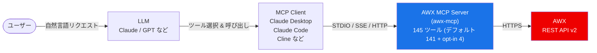

# AWX MCP Server

MCP クライアントから AWX の失敗したジョブや実行ログを確認し、呼び出し元の AWX 権限で自動化を管理できます。ローカルの stdio プロセスとして実行するか、ユーザーごとのトークンを渡す中央サーバーとして共有できます。


[English](README.md) | [한국어](README.ko.md)

現在は Git リポジトリからインストールできます。**PyPI には公開しません**。初回 release、GHCR イメージ、MCP Registry への公開は未実施のため、Release badge は release なしと表示される場合があります。

## クイックスタート

まず uv をインストールしてください: https://docs.astral.sh/uv/

自分の AWX URL とトークンを設定します。以下はトークンをコマンドに直接記述せず、環境変数で渡す読み取り専用の設定です。

```bash
export ANSIBLE_BASE_URL="https://awx.example.com/"
export ANSIBLE_TOKEN="REPLACE_WITH_YOUR_AWX_TOKEN"
export AWX_MCP_READ_ONLY=true
claude mcp add --scope project awx \
  -e 'ANSIBLE_BASE_URL=${ANSIBLE_BASE_URL}' \
  -e 'ANSIBLE_TOKEN=${ANSIBLE_TOKEN}' \
  -e 'AWX_MCP_READ_ONLY=${AWX_MCP_READ_ONLY}' \
  -- uvx --from git+https://github.com/lycorp-jp/awx-mcp awx-mcp
```

`AWX_MCP_READ_ONLY=true` は任意の初期設定です。書き込みツールが必要で、AWX ロールにも権限がある場合に解除してください。サーバープロセスは MCP クライアントから起動します。Claude Desktop などの設定は [MCPクライアント連携](#mcpクライアント連携) を参照してください。

単一引用符により `.mcp.json` に `${VAR}` 参照をそのまま保存します。環境変数を設定したシェルから Claude Code を起動してください。環境変数の展開: https://code.claude.com/docs/en/mcp#environment-variable-expansion-in-mcpjson

## 読み取り専用 fixture デモ


GIF はローカルの fake AWX fixture に対する実際の MCP `list_jobs(status="failed")` と `get_job_stdout(job_id=42)` 呼び出しを示します。データとトークンはすべて架空です。実際の AWX 運用環境や LLM 会話の録画ではなく、MCP プロトコルの動作を再現したデモです。

[実行記録](docs/demo.txt) · [再現方法](docs/demo.tape)

## 目次

- [クイックスタート](#クイックスタート)
- [読み取り専用 fixture デモ](#読み取り専用-fixture-デモ)
- [前提条件](#前提条件)
- [アーキテクチャ](#アーキテクチャ)
- [互換性](#互換性)
- [機能](#機能)
- [インストール](#インストール)
- [デプロイモード](#デプロイモード)
- [設定](#設定)
- [Credential Management (opt-in)](#credential-management-opt-in)
- [MCPクライアント連携](#mcpクライアント連携)
- [使用例](#使用例)
- [ツール一覧](#ツール一覧)
- [トラブルシューティング](#トラブルシューティング)
- [コントリビューション](#コントリビューション)
- [行動規範](#行動規範)
- [変更履歴](#変更履歴)
- [セキュリティポリシー](#セキュリティポリシー)
- [ライセンス](#ライセンス)

---

## 前提条件

- アクセス可能な AWX インスタンスとそのベース URL（REST API v2）、および適切な権限を持つ API トークン（またはユーザー名 + パスワード）
- uv: https://docs.astral.sh/uv/（`uvx` を提供し、クローンなしで git リポジトリから直接サーバーを実行できます）

---

## アーキテクチャ



> LLM がユーザーのリクエストを解析して適切な MCP ツールを選択し、AWX MCP サーバーが AWX REST API を呼び出して結果を返します。

> ローカルクライアントには stdio、新しいリモートデプロイには Streamable HTTP を推奨します。SSE は既存クライアント向けの legacy 互換 transport として維持します（`--serve --sse`、`/sse`）。

---

## 互換性

| コンポーネント | サポート |
|--------------|---------|
| AWX | 24.6.1（REST API v2） |
| Python | ≥ 3.10 |
| MCP トランスポート | STDIO、SSE、Streamable HTTP |
| バージョン方針 | サーバーバージョンは検証済み AWX バージョンに合わせます。例は `24.6.1` で、同じ AWX に対するサーバーのみの release は `24.6.1.1` のように 4 番目の数字を追加します。これは方針の例であり、release tag の存在を意味しません。 |
| その他の AWX / Ansible Tower バージョン | この表の検証対象ではありません。導入前に利用するインスタンスで確認してください。 |

---

## 機能

| 機能 | 利点 |
|------|------|
| AWX の 20 領域を扱う 145 ツール | インベントリ、ジョブ、ワークフロー、プロジェクト、RBAC、システム状態を 1 つの MCP クライアントで確認できます。 |
| ローカル stdio と中央 `--serve` | 個人用プロセス、または呼び出し元ごとの AWX トークンを使う共有サーバーを選べます。 |
| `AWX_MCP_READ_ONLY=true` | 起動時に読み取りツールだけを公開します。AWX RBAC も適用されます。 |
| 名前フィルターとページネーション | 名前でリソースを検索し、クライアントに返すレコード数を制限できます。 |
| トークンキャッシュ | ローカルでユーザー名とパスワードを使う場合、サーバーが生成した OAuth2 トークンを再利用します。 |
| TLS と opt-in ローカルログ | 通信中の認証情報を保護し、中央サーバーでは呼び出し元ごとのツール実行を記録できます。 |

デフォルトでは 141 ツールが有効です。認証情報/ユーザー書き込みツール 4 個は明示的な opt-in が必要です。その他のツールも機密のインベントリ変数、ジョブ出力、アカウント情報を返す場合があります。書き込みの有効化前に [Credential Management](#credential-management-opt-in) と [セキュリティガイド](docs/security.ja.md) を確認してください。

---

## インストール

パッケージの配布元は GitHub です。現在は main branch を使うか、`@<commit-sha-or-existing-ref>` を追加して実在する revision を選択してください。初回 release 前に release tag があるとは仮定しません。

```bash
uvx --from git+https://github.com/lycorp-jp/awx-mcp awx-mcp
```

`uvx` はリポジトリを取得、ビルドしてキャッシュします。main branch のキャッシュを更新する場合は一度 `--refresh` を追加してください。開発時は `uv run --directory /path/to/awx-mcp awx-mcp --stdio` を使います。その環境の `awx-mcp --version` でインストール済みバージョンを確認できます。

### Docker / Podman

現在はローカル checkout からコンテナをビルドできます。イメージの既定コマンドは中央 HTTP サーバーを起動するため、以下の stdio 実行では `--stdio` を明示してください。

```bash
docker build -t awx-mcp:local .
docker run -i --rm -e ANSIBLE_BASE_URL -e ANSIBLE_TOKEN -e AWX_MCP_READ_ONLY awx-mcp:local --stdio
```

値は環境変数で渡し、MCP stdio に `-t` は使用しないでください。GHCR イメージと tag を使うコマンドは初回 release 公開後に案内します。複数ユーザーの HTTP、プロキシ、TLS、replica の設定は [デプロイガイド](docs/deployment.ja.md) を参照してください。

---

## デプロイモード

| コマンド | モード | 認証 |
|---------|--------|------|
| `awx-mcp` / `awx-mcp --stdio` | ローカル stdio | 自分の AWX トークン、またはユーザー名/パスワード |
| `awx-mcp --remote <URL>` | 中央サーバーへのローカルプロキシ | 自分の AWX トークンのみ |
| `awx-mcp --serve` | 中央 Streamable HTTP サーバー | 各リクエストの呼び出し元トークン |

中央サーバーは静的な AWX 認証情報を無視します。TLS でトークンを保護し、ネットワークアクセスを制限してください。`--host` と `--port` は環境変数より優先されます。[デプロイ例、直接 HTTP 接続、replica 設定](docs/deployment.ja.md) と [TLS およびログ](docs/security.ja.md) を参照してください。

### Toolset の選択と読み取り専用モード

`--toolsets jobs,job_templates` または `AWX_MCP_TOOLSETS` で公開するツールを選択します。CLI オプションが環境変数より優先され、既定値は `all` です。不明な名前や空の選択は起動時に拒否されます。`--serve` では全呼び出し元に適用されます。`--remote` では一部の toolset の選択を拒否するため、中央サーバー側で設定してください。

`--read-only` と `AWX_MCP_READ_ONLY=true` のいずれかを設定すると読み取り専用になります。ローカルと中央サーバーでは読み取りツールだけを公開します。プロキシは `X-AWX-Read-Only: true` を転送し、そのセッションを制限します。既定では AWX RBAC が許可する書き込みを含めて 141 ツールを公開します。

```bash
awx-mcp --toolsets jobs,job_templates --read-only
```

<!-- TOOLSET_SUMMARY:BEGIN -->
<!-- Generated by scripts/gen_tool_docs.py. Do not edit by hand. -->

| Toolset | Default tools | With credential opt-in |
|---------|---------------|------------------------|
| `ad_hoc` | 3 | 3 |
| `credentials` | 5 | 7 |
| `execution_environments` | 5 | 5 |
| `groups` | 7 | 7 |
| `hosts` | 5 | 5 |
| `instances` | 4 | 4 |
| `inventories` | 14 | 14 |
| `job_templates` | 13 | 13 |
| `jobs` | 7 | 7 |
| `labels` | 2 | 2 |
| `notifications` | 3 | 3 |
| `organizations` | 5 | 5 |
| `projects` | 11 | 11 |
| `rbac` | 7 | 7 |
| `schedules` | 5 | 5 |
| `system` | 9 | 9 |
| `teams` | 5 | 5 |
| `users` | 3 | 5 |
| `workflow_jobs` | 11 | 11 |
| `workflow_templates` | 17 | 17 |
<!-- TOOLSET_SUMMARY:END -->

---

## 設定

環境変数で AWX 接続情報を設定します。MCP クライアント設定の `env` ブロックに直接記述してください。

### 必須

| 変数 | 説明 | 例 |
|------|------|-----|
| `ANSIBLE_BASE_URL` | AWX インスタンス URL（末尾の `/` は任意） | `https://awx.example.com` |

### 認証（どちらか一方を選択）

**方法 1: API トークン（推奨）**

AWX UI で事前に作成したトークンを使います。AWX の方針により期限切れや失効が発生します。必要最小限の権限と scope を選び、必要に応じて更新してください。

| 変数 | 説明 |
|------|------|
| `ANSIBLE_TOKEN` | 事前生成済みの API トークン |

> AWX UI で作成: ユーザープロフィール > トークン > 追加。読み取り専用なら Read scope、書き込みが必要な場合だけ Write を選びます。AWX RBAC もアクセスを制限します。

**方法 2: ユーザー名 + パスワード**

サーバーが自動的に OAuth2 トークンを生成してキャッシュします。

| 変数 | 説明 |
|------|------|
| `ANSIBLE_USERNAME` | AWX ユーザー名 |
| `ANSIBLE_PASSWORD` | AWX パスワード |

### オプション

| 変数 | デフォルト | 説明 |
|------|-----------|------|
| `ANSIBLE_SSL_VERIFY` | `true` | TLS 証明書検証（`true`/`false`）。検証は**デフォルトで有効**です。`false` にすると検証が無効になります（**非推奨（危険）** - 警告がログに出力されます。CA バンドルを持たない開発/自己署名環境でのみ使用してください）。 |
| `ANSIBLE_CA_BUNDLE` | 未設定 | 検証が有効な場合に信頼するカスタム CA バンドル/自己署名証明書（PEM）へのパス。検証を無効にせずに、プライベート CA を使用する AWX インスタンスへ接続できます。パスが存在しない場合、サーバーは起動時に即座に失敗します。 |
| `ANSIBLE_LOG_LEVEL` | `INFO` | ログレベル（`DEBUG`、`INFO`、`WARNING`、`ERROR`） |
| `AWX_HTTP_TIMEOUT_READ` | `90` | AWX API リクエスト 1 件あたりの読み取りタイムアウト（秒）。低速な AWX で大きな `get_job_stdout` / `get_job_events` 呼び出しがタイムアウトする場合に増やします。 |
| `AWX_MCP_ENABLE_CREDENTIAL_MANAGEMENT` | `false` | Form mode elicitation で機密データを収集する 4 つの認証情報/ユーザー書き込みツールを有効化するか。[Credential Management (opt-in)](#credential-management-opt-in) を参照。 |
| `AWX_MCP_TOOLSETS` | `all` | ツールモジュール名をカンマで区切ります。`--toolsets` が優先されます。`--serve` ではサーバー全体に適用し、`--remote` では一部の toolset の選択を拒否します。 |
| `AWX_MCP_READ_ONLY` | `false` | 読み取り専用モード。`--serve` の中央サーバーでは、`true` にするとすべての書き込み/破壊的ツールがグローバルに登録解除されます(ユーザー側で再有効化はできません)。`--remote` プロキシモードでは、`true` はそのユーザーのセッションのみを制限します(プロキシが `X-AWX-Read-Only` を送信し、サーバーはその呼び出し元の書き込み呼び出しを拒否します)。あくまで自己制限としての機能です - [デプロイモード](docs/deployment.ja.md) を参照。 |
| `AWX_MCP_REMOTE_URL` | 未設定 | プロキシモード用の中央サーバー URL(`--remote <URL>` と同等。フラグの方が優先されます)。 |
| `AWX_MCP_HOST` | `127.0.0.1` | `--serve` サーバーのバインドホスト。`--host` で上書きされます。 |
| `AWX_MCP_PORT` | `8000` | `--serve` サーバーのバインドポート。`--port` で上書きされます。 |
| `AWX_MCP_TLS_ENABLE` | `false` | `true` にすると、`--serve` サーバーがプロセス内で HTTPS を配信します（uvicorn）。呼び出し元のトークンがリクエストヘッダーで送信されるため、強く推奨されます。 |
| `AWX_MCP_TLS_CERT` | 未設定 | サーバー TLS 証明書（PEM）へのパス。`AWX_MCP_TLS_ENABLE=true` の場合に必須で、パスが存在しない/見つからない場合はサーバーが起動時に即座に失敗します。 |
| `AWX_MCP_TLS_KEY` | 未設定 | サーバー TLS 秘密鍵（PEM）へのパス。TLS が有効な場合に必須です。 |
| `AWX_MCP_TLS_KEY_PASSWORD` | 未設定 | 秘密鍵が暗号化されている場合のパスワード。任意。 |
| `AWX_MCP_STATELESS_HTTP` | `false` | ステートレス streamable-http モード。各リクエストが自己完結し、プロセスにセッションごとの状態を保持しません。単純なラウンドロビン型ロードバランサーの背後で複数の `--serve` レプリカを運用する場合に必要です（そうしないと、あるレプリカで作成されたセッションが別のレプリカにルーティングされた際に 404 になります）。デフォルト（off）では、単一インスタンス / sse 構成のステートフルなセッション動作がそのまま維持されます。 |
| `AWX_MCP_USAGE_LOG_FILE` | 未設定 | JSON Lines 形式の利用ログファイルへのパス。MCP ツール呼び出しごとに 1 件の JSON ドキュメント（`@timestamp`、`type`、`user`、`tool`、`params`（マスキングされた呼び出し引数）、`trace_id`、`server_version`、`success`、`latency_ms`、`auth_mode`、`transport`、`awx_host`、失敗時の `error{type,message}`）が記録されます。`--remote` プロキシを含むすべてのモードで動作します。未設定の場合は計装が無効になります。[詳細利用ログ](docs/security.ja.md#詳細利用ログ) を参照。 |
| `AWX_MCP_USAGE_USER` | 未設定 | プロキシのローカル利用ログで `user` フィールドに使うラベル（プロキシモードにはユーザー名を解決する AWX アクセスがないため、デフォルトは `local`）。 |
| `AWX_MCP_ACCESS_LOG_FILE` | 未設定 | `--serve` サーバー用の JSON Lines アクセスログファイルへのパス。受信したすべての HTTP リクエストが記録されます（クライアント IP、メソッド、パス、ステータス、レイテンシ）。利用ログと同様に、毎日深夜（UTC）にローテーションします。`--serve` モードでのみ有効です - stdio と `--remote` プロキシには HTTP ソケットがありません。 |
| `AWX_MCP_SERVER_LOG_FILE` | 未設定 | サーバー診断ログファイルへのパス。既存の stderr 診断・エラー出力をそのままファイルにも記録します。未設定の場合は stderr のみで、ファイルは作成されません。 |
| `AWX_MCP_SERVER_LOG_FORMAT` | `plain` | サーバー診断ログの形式: `plain` または `json`。 |
| `AWX_MCP_LOG_BACKUP_COUNT` | `7` | ローテーションしたログファイルの保持数。両方のログファイルは毎日 UTC 深夜 0 時に日付サフィックス付きでローテーションされます。 |

### TLS / 証明書検証

TLS 証明書検証は既定で有効です。プライベート CA は `ANSIBLE_CA_BUNDLE` で信頼させてください。`--remote` ではこの検証設定は AWX ではなく中央サーバーに適用されます。ネットワークに公開する中央サーバーには TLS とアクセス制限が必要です。利用/アクセスログは opt-in、診断ログは既定で stderr に出力します。stdout は MCP メッセージ専用です。[TLS、ログフィールド、マスキングの限界、replica の注意事項](docs/security.ja.md) を参照してください。

---

## Credential Management (opt-in)

`create_credential`、`update_credential`、`create_user`、`update_user` は **Form mode elicitation** でパスワードや認証情報入力を収集するため、既定では登録されません。その他のツールもジョブ stdout やインベントリ変数などの機密データを返す場合があります。

有効化するには以下を設定してください:

```bash
AWX_MCP_ENABLE_CREDENTIAL_MANAGEMENT=true
```

Form mode elicitation は MCP 仕様の観点で機密データに対して非準拠の状態です。クライアント側のロギングやその他の中間システムによってレスポンスが露出する可能性があります。信頼できる隔離された環境でのみ使用してください。また、`--serve` とは**併用しないでください**（共有ネットワークデプロイでは、ローカル stdio プロセスの場合よりリスクが悪化します）。脅威モデルと開示ポリシーの詳細については [SECURITY.md](./SECURITY.md) を参照してください。

---

## MCPクライアント連携

### Claude Desktop

`claude_desktop_config.json` に以下を追加します:

```json
{
  "mcpServers": {
    "awx": {
      "command": "uvx",
      "args": ["--from", "git+https://github.com/lycorp-jp/awx-mcp", "awx-mcp"],
      "env": {
        "ANSIBLE_BASE_URL": "https://awx.example.com/",
        "ANSIBLE_TOKEN": "your_api_token"
      }
    }
  }
}
```

### Claude Code（CLI）

```bash
claude mcp add awx \
  -e ANSIBLE_BASE_URL=https://awx.example.com/ \
  -e ANSIBLE_TOKEN=your_api_token \
  -- uvx --from git+https://github.com/lycorp-jp/awx-mcp awx-mcp
```

### Cursor

以下のリンクは**読み取り専用の設定テンプレート**を追加します。接続設定はまだ完了しません。起動前に Cursor の MCP 設定で `REPLACE_WITH_YOUR_AWX_HTTPS_URL` と `REPLACE_WITH_YOUR_AWX_TOKEN` を**両方とも置換してください**。この設定を version control に含めないでください。

cursor://anysphere.cursor-deeplink/mcp/install?name=awx&config=eyJjb21tYW5kIjoidXZ4IiwiYXJncyI6WyItLWZyb20iLCJnaXQraHR0cHM6Ly9naXRodWIuY29tL2x5Y29ycC1qcC9hd3gtbWNwIiwiYXd4LW1jcCJdLCJlbnYiOnsiQU5TSUJMRV9CQVNFX1VSTCI6IlJFUExBQ0VfV0lUSF9ZT1VSX0FXWF9IVFRQU19VUkwiLCJBTlNJQkxFX1RPS0VOIjoiUkVQTEFDRV9XSVRIX1lPVVJfQVdYX1RPS0VOIiwiQVdYX01DUF9SRUFEX09OTFkiOiJ0cnVlIn19

公式の形式: https://cursor.com/docs/mcp/install-links

### VS Code (native MCP)

`.vscode/mcp.json` またはユーザー MCP 設定に追加します。VS Code が URL とトークンの入力を求め、トークン入力は非表示になります。`env` の参照は以下の `inputs` に対応します。

```json
{
  "inputs": [
    {
      "id": "awx-url",
      "type": "promptString",
      "description": "AWX HTTPS ベース URL"
    },
    {
      "id": "awx-token",
      "type": "promptString",
      "description": "AWX API トークン",
      "password": true
    }
  ],
  "servers": {
    "awx": {
      "type": "stdio",
      "command": "uvx",
      "args": [
        "--from",
        "git+https://github.com/lycorp-jp/awx-mcp",
        "awx-mcp"
      ],
      "env": {
        "ANSIBLE_BASE_URL": "${input:awx-url}",
        "ANSIBLE_TOKEN": "${input:awx-token}",
        "AWX_MCP_READ_ONLY": "true"
      }
    }
  }
}
```

設定リファレンス: https://code.visualstudio.com/docs/agents/reference/mcp-configuration

### Cline（VS Code）

MCP サーバー設定に以下を追加します:

```json
{
  "awx": {
    "command": "uvx",
    "args": ["--from", "git+https://github.com/lycorp-jp/awx-mcp", "awx-mcp"],
    "env": {
      "ANSIBLE_BASE_URL": "https://awx.example.com/",
      "ANSIBLE_TOKEN": "your_api_token"
    }
  }
}
```

### 中央サーバーへの接続

自分の AWX トークンで stdio プロキシ、または直接 Streamable HTTP 接続を使います。プロキシには `ANSIBLE_TOKEN` が必要ですが `ANSIBLE_BASE_URL` は不要です。ユーザー名/パスワード認証はローカルモードのみです。[プロキシ/直接 HTTP の完全な設定と TLS 要件](docs/deployment.ja.md) を参照してください。

---

## 使用例

MCP クライアント（Claude など）に自然言語でリクエストすると、サーバーが適切なツールを呼び出します。

### インベントリ管理

```
「Production インベントリのホスト一覧を表示して」
→ list_hosts(inventory_id=1)

「web-server-01 を Production インベントリに追加して」
→ create_host(name="web-server-01", inventory_id=1)

「DB サーバーを database グループにまとめて」
→ create_group(...) + add_host_to_group(...)
```

### ジョブ実行とモニタリング

```
「Deploy App ジョブテンプレートを実行して」
→ launch_job(template_id=5)

「さっき実行したジョブの状態を確認して」
→ get_job(job_id=123)

「ジョブの実行ログを表示して」
→ get_job_stdout(job_id=123)

「失敗したジョブを再実行して」
→ relaunch_job(job_id=123)
```

### プロジェクト & SCM

```
「すべてのプロジェクトを最新の状態に同期して」
→ list_projects() + sync_project(project_id=...) を繰り返し実行

「my-project にあるプレイブック一覧を表示して」
→ list_project_playbooks(project_id=3)
```

### ワークフロー

```
「デプロイワークフローを実行して、承認が必要なら承認して」
→ launch_workflow(template_id=10)
→ list_workflow_approvals() → approve_workflow(approval_id=...)

「ワークフロー実行結果で失敗したノードを確認して」
→ list_workflow_job_nodes(workflow_job_id=50)
```

### RBAC & ユーザー管理

```
「developer チームに Production インベントリの読み取り権限を付与して」
→ list_object_roles(...) + grant_role_to_team(role_id=..., team_id=...)

「新しいユーザー john を作成して DevOps チームに追加して」
→ create_user(...) + grant_role_to_user(...)
```

### システム管理

```
「AWX のバージョンとクラスターの状態を確認して」
→ get_ansible_version() + list_instances()

「90 日以上前のジョブ記録を削除して」
→ list_system_job_templates() → launch_system_job(template_id=..., extra_vars='{"days": 90}')
```

---

## ツール一覧

合計 **145 個**のツールを 20 モジュールで提供します。デフォルトでは 141 個が登録され、以下の **opt-in** とマークされた 4 つは `AWX_MCP_ENABLE_CREDENTIAL_MANAGEMENT=true` の場合のみ公開されます（[Credential Management (opt-in)](#credential-management-opt-in) 参照）。

### 名前で検索する

名前を持つコレクションを扱うすべての `list_*` ツールは、任意の名前引数を受け取ります。
AWX が**サーバーサイド**で大文字小文字を区別しない部分一致として適用するため、
コレクションをページ送りせずに 1 回の呼び出しで名前を ID に解決できます。

```
list_job_templates(template_name="deploy")      -> "deploy" に一致するテンプレートのみ
list_projects(project_name="platform")          -> "platform" に一致するプロジェクトのみ
```

引数名はリソースに応じて決まります（`project_name`、`inventory_name`、
`credential_name` など）。`list_hosts` と `list_instances` は `hostname`、
`list_users` は `username` を使用します。引数を省略した場合は従来どおり全件を
一覧します。

名前フィルターを持たないものが 2 種類あります。`list_roles` は、AWX がロール名を
保存せず role フィールドから導出するためフィルターできません。実行記録の一覧
（`list_jobs`、`list_project_updates` など）は、名前ではなくステータスと親
テンプレートで照会します。

<details>
<summary><strong>145個すべてのツールを表示</strong></summary>

<!-- TOOL_TABLES:BEGIN -->
<!-- Generated by scripts/gen_tool_docs.py. Do not edit by hand. -->

### `ad_hoc` (3 tools, 3 default)

| Tool | Access | Summary |
|------|--------|---------|
| `cancel_ad_hoc_command` | Write | Cancel a running AWX ad hoc command. |
| `get_ad_hoc_command` | Read | Get details for one AWX ad hoc command. |
| `run_ad_hoc_command` | Write | Run an AWX ad hoc command. |

### `credentials` (7 tools, 5 default)

| Tool | Access | Summary |
|------|--------|---------|
| `copy_credential` | Write | Copy an AWX credential. |
| `create_credential` | Write (opt-in) | Create an AWX credential. |
| `delete_credential` | Write | Delete an AWX credential. |
| `get_credential` | Read | Get details for one AWX credential. |
| `list_credential_types` | Read | List AWX credential types. |
| `list_credentials` | Read | List AWX credentials. |
| `update_credential` | Write (opt-in) | Update AWX credential metadata or inputs. |

### `execution_environments` (5 tools, 5 default)

| Tool | Access | Summary |
|------|--------|---------|
| `create_execution_environment` | Write | Create an AWX execution environment. |
| `delete_execution_environment` | Write | Delete an AWX execution environment. |
| `get_execution_environment` | Read | Get details for one AWX execution environment. |
| `list_execution_environments` | Read | List AWX execution environments. |
| `update_execution_environment` | Write | Update an AWX execution environment. |

### `groups` (7 tools, 7 default)

| Tool | Access | Summary |
|------|--------|---------|
| `add_host_to_group` | Write | Associate an existing AWX host with a group. |
| `create_group` | Write | Create an AWX group inside an inventory. |
| `delete_group` | Write | Delete an AWX group. |
| `get_group` | Read | Get details for one AWX group. |
| `list_groups` | Read | List AWX inventory groups. |
| `remove_host_from_group` | Write | Remove AWX host membership from a group. |
| `update_group` | Write | Update AWX group metadata and variables. |

### `hosts` (5 tools, 5 default)

| Tool | Access | Summary |
|------|--------|---------|
| `create_host` | Write | Create an AWX host in an inventory. |
| `delete_host` | Write | Delete an AWX host. |
| `get_host` | Read | Get details for one AWX host. |
| `list_hosts` | Read | List AWX hosts. |
| `update_host` | Write | Update AWX host metadata and variables. |

### `instances` (4 tools, 4 default)

| Tool | Access | Summary |
|------|--------|---------|
| `get_instance` | Read | Get details for one AWX cluster instance. |
| `get_instance_group` | Read | Get details for one AWX instance group. |
| `list_instance_groups` | Read | List AWX instance groups. |
| `list_instances` | Read | List AWX cluster instances. |

### `inventories` (14 tools, 14 default)

| Tool | Access | Summary |
|------|--------|---------|
| `cancel_inventory_update` | Write | Cancel a running AWX inventory update. |
| `create_inventory` | Write | Create an AWX inventory in an organization. |
| `create_inventory_source` | Write | Create an AWX inventory source for dynamic host sync. |
| `delete_inventory` | Write | Delete an AWX inventory. |
| `delete_inventory_source` | Write | Delete an AWX inventory source. |
| `get_inventory` | Read | Get details for one AWX inventory. |
| `get_inventory_source` | Read | Get details for one AWX inventory source. |
| `get_inventory_update` | Read | Get details for one AWX inventory update. |
| `list_inventories` | Read | List AWX inventories. |
| `list_inventory_sources` | Read | List AWX inventory sources. |
| `list_inventory_updates` | Read | List AWX inventory source sync history. |
| `sync_inventory_source` | Write | Start an AWX inventory source sync. |
| `update_inventory` | Write | Update AWX inventory metadata. |
| `update_inventory_source` | Write | Update an existing AWX inventory source. |

### `job_templates` (13 tools, 13 default)

| Tool | Access | Summary |
|------|--------|---------|
| `associate_credential_with_template` | Write | Associate a credential with an AWX job template. |
| `copy_job_template` | Write | Create a copy of an AWX job template. |
| `create_job_template` | Write | Create an AWX job template for single playbook execution. |
| `delete_job_template` | Write | Delete an AWX job template. |
| `delete_job_template_survey` | Write | Delete the survey spec from an AWX job template. |
| `disassociate_credential_from_template` | Write | Disassociate a credential from an AWX job template. |
| `get_job_template` | Read | Get details for a specific AWX job template. |
| `get_job_template_survey` | Read | Get the survey spec for an AWX job template. |
| `launch_job` | Write | Launch a single AWX playbook execution from a job template. |
| `list_job_templates` | Read | List AWX job templates for single playbook executions. |
| `list_template_credentials` | Read | List credentials attached to an AWX job template. |
| `set_job_template_survey` | Write | Set the survey spec for an AWX job template. |
| `update_job_template` | Write | Update an existing AWX job template. |

### `jobs` (7 tools, 7 default)

| Tool | Access | Summary |
|------|--------|---------|
| `cancel_job` | Write | Cancel a running AWX regular playbook job. |
| `get_job` | Read | Get details for a single AWX playbook execution job. |
| `get_job_events` | Read | Get event stream records for a specific AWX regular job. |
| `get_job_host_summaries` | Read | Get AWX per-host result summaries for a regular playbook job. |
| `get_job_stdout` | Read | Get stdout logs for a specific AWX regular playbook job. |
| `list_jobs` | Read | List AWX regular playbook jobs, optionally filtered by status. |
| `relaunch_job` | Write | Relaunch a completed or failed AWX regular playbook job. |

### `labels` (2 tools, 2 default)

| Tool | Access | Summary |
|------|--------|---------|
| `create_label` | Write | Create an AWX label in an organization. |
| `list_labels` | Read | List AWX labels. |

### `notifications` (3 tools, 3 default)

| Tool | Access | Summary |
|------|--------|---------|
| `get_notification_template` | Read | Get details for one AWX notification template. |
| `list_notification_templates` | Read | List AWX notification templates. |
| `test_notification_template` | Write | Send a test event through an AWX notification template. |

### `organizations` (5 tools, 5 default)

| Tool | Access | Summary |
|------|--------|---------|
| `create_organization` | Write | Create an AWX organization. |
| `delete_organization` | Write | Delete an AWX organization. |
| `get_organization` | Read | Get details for one AWX organization. |
| `list_organizations` | Read | List AWX organizations. |
| `update_organization` | Write | Update an AWX organization. |

### `projects` (11 tools, 11 default)

| Tool | Access | Summary |
|------|--------|---------|
| `cancel_project_update` | Write | Cancel a running AWX project update. |
| `create_project` | Write | Create an AWX project for playbook content. |
| `delete_project` | Write | Delete an AWX project. |
| `get_project` | Read | Get details for one AWX project. |
| `get_project_update` | Read | Get details for one AWX project update. |
| `get_project_update_stdout` | Read | Get AWX stdout logs for a project update. |
| `list_project_playbooks` | Read | List AWX playbooks discovered in a project. |
| `list_project_updates` | Read | List AWX project SCM sync history. |
| `list_projects` | Read | List AWX projects. |
| `sync_project` | Write | Start an AWX project SCM sync. |
| `update_project` | Write | Update AWX project metadata and SCM settings. |

### `rbac` (7 tools, 7 default)

| Tool | Access | Summary |
|------|--------|---------|
| `get_role` | Read | Get details for one AWX RBAC role. |
| `grant_role_to_team` | Write | Grant an AWX role to a team. |
| `grant_role_to_user` | Write | Grant an AWX role to a user. |
| `list_object_roles` | Read | List AWX RBAC roles for one specific resource. |
| `list_roles` | Read | List all AWX RBAC roles. |
| `revoke_role_from_team` | Write | Revoke an AWX role from a team. |
| `revoke_role_from_user` | Write | Revoke an AWX role from a user. |

### `schedules` (5 tools, 5 default)

| Tool | Access | Summary |
|------|--------|---------|
| `create_schedule` | Write | Create an AWX schedule for recurring launches. |
| `delete_schedule` | Write | Delete an AWX schedule. |
| `get_schedule` | Read | Get details for one AWX schedule. |
| `list_schedules` | Read | List AWX schedules, optionally filtered by template. |
| `update_schedule` | Write | Update an AWX schedule. |

### `system` (9 tools, 9 default)

| Tool | Access | Summary |
|------|--------|---------|
| `get_ansible_version` | Read | Get AWX/Ansible controller version and health information. |
| `get_config` | Read | Get AWX instance configuration metadata. |
| `get_dashboard_stats` | Read | Get AWX dashboard summary statistics. |
| `get_system_job` | Read | Get details for a specific AWX maintenance system job run. |
| `get_system_job_template` | Read | Get details for a specific AWX system job template. |
| `launch_system_job` | Write | Launch an AWX maintenance system job from a system job template. |
| `list_activity_stream` | Read | List AWX activity stream audit entries. |
| `list_system_job_templates` | Read | List AWX system job templates for maintenance operations. |
| `list_system_jobs` | Read | List AWX system job executions. |

### `teams` (5 tools, 5 default)

| Tool | Access | Summary |
|------|--------|---------|
| `create_team` | Write | Create an AWX team within an organization. |
| `delete_team` | Write | Delete an AWX team. |
| `get_team` | Read | Get details for one AWX team. |
| `list_teams` | Read | List AWX teams, optionally scoped to an organization. |
| `update_team` | Write | Update an AWX team. |

### `users` (5 tools, 3 default)

| Tool | Access | Summary |
|------|--------|---------|
| `create_user` | Write (opt-in) | Create an AWX user account. |
| `delete_user` | Write | Delete an AWX user account. |
| `get_user` | Read | Get details for one AWX user. |
| `list_users` | Read | List AWX users. |
| `update_user` | Write (opt-in) | Update an AWX user account. |

### `workflow_jobs` (11 tools, 11 default)

| Tool | Access | Summary |
|------|--------|---------|
| `approve_workflow` | Write | Approve a pending AWX workflow approval request. |
| `cancel_workflow_job` | Write | Cancel a running AWX workflow orchestration run. |
| `deny_workflow` | Write | Deny a pending AWX workflow approval request. |
| `get_workflow_approval` | Read | Get details for a specific AWX workflow approval request. |
| `get_workflow_approval_template` | Read | Get a workflow job template node by ID (may or may not be an approval node). |
| `get_workflow_job` | Read | Get details for a single AWX workflow orchestration run. |
| `list_workflow_approval_templates` | Read | List AWX workflow approval template nodes. |
| `list_workflow_approvals` | Read | List AWX workflow approval requests, optionally filtered by status. |
| `list_workflow_job_nodes` | Read | List node outcomes for an executed AWX workflow job. |
| `list_workflow_jobs` | Read | List AWX workflow orchestration runs, optionally filtered by status. |
| `relaunch_workflow_job` | Write | Relaunch a completed or failed AWX workflow orchestration run. |

### `workflow_templates` (17 tools, 17 default)

| Tool | Access | Summary |
|------|--------|---------|
| `add_workflow_node_always_link` | Write | Add an AWX workflow always-run edge between template nodes. |
| `add_workflow_node_failure_link` | Write | Add an AWX workflow failure edge between template nodes. |
| `add_workflow_node_success_link` | Write | Add an AWX workflow success edge between template nodes. |
| `copy_workflow_template` | Write | Create a copy of an AWX workflow template. |
| `create_workflow_template` | Write | Create an AWX workflow template for multi-step orchestration. |
| `create_workflow_template_node` | Write | Create a node in an AWX workflow template. |
| `delete_workflow_template` | Write | Delete an AWX workflow template. |
| `delete_workflow_template_node` | Write | Delete an AWX workflow template node. |
| `delete_workflow_template_survey` | Write | Delete the survey spec from an AWX workflow template. |
| `get_workflow_template` | Read | Get details for a specific AWX workflow template. |
| `get_workflow_template_node` | Read | Get details for a specific AWX workflow template node. |
| `get_workflow_template_survey` | Read | Get the survey spec for an AWX workflow template. |
| `launch_workflow` | Write | Launch an AWX multi-step workflow from a workflow template. |
| `list_workflow_template_nodes` | Read | List nodes defined in an AWX workflow template. |
| `list_workflow_templates` | Read | List AWX workflow templates for multi-step orchestration. |
| `set_workflow_template_survey` | Write | Set the survey spec for an AWX workflow template. |
| `update_workflow_template` | Write | Update an existing AWX workflow template. |
<!-- TOOL_TABLES:END -->

</details>

---

## トラブルシューティング

### サーバーが起動しない

**`ValueError: ANSIBLE_BASE_URL environment variable is required`**

環境変数が設定されていません。MCP クライアント設定の `env` ブロックに `ANSIBLE_BASE_URL` を追加してください。

**`ValueError: Authentication is required`**

`ANSIBLE_TOKEN` または `ANSIBLE_USERNAME` + `ANSIBLE_PASSWORD` のいずれかを設定する必要があります。

### 接続できない

**SSL 証明書エラー**

TLS 検証はデフォルトで有効です。AWX インスタンスがプライベート/内部 CA が発行した証明書、または自己署名証明書を使用している場合は、`ANSIBLE_CA_BUNDLE` にその CA/証明書の PEM ファイルパスを設定してください - 検証を有効にしたまま、その証明書を信頼できます。CA 証明書が入手できないなど最後の手段としてのみ、`ANSIBLE_SSL_VERIFY` を `"false"`（文字列）に設定してください。この場合、検証が完全に無効化され、サーバーが警告をログに出力します。詳細は [TLS 証明書検証](docs/security.ja.md#tls--証明書検証) を参照してください。

**Connection refused / timeout**

- `ANSIBLE_BASE_URL` が正しいか確認してください
- AWX インスタンスが起動しているか確認してください
- ファイアウォール/ネットワーク設定を確認してください

### MCP スキーマエラー

**`Does not adhere to MCP server configuration schema`**

`env` ブロックのすべての値は**文字列**である必要があります。`false`（boolean）ではなく `"false"`（文字列）を使用してください。

### 権限エラー

**403 Forbidden**

API トークンまたはユーザーアカウントが該当リソースへの権限を持っていません。AWX 管理者に適切なロールを付与するよう依頼してください。

### デバッグ

ログレベルを `DEBUG` に設定すると、詳細な API リクエスト/レスポンスログを確認できます:

```json
"ANSIBLE_LOG_LEVEL": "DEBUG"
```

---

## コントリビューション

コントリビューションを歓迎します。Issue の提出、変更の提案、PR のオープン方法については [CONTRIBUTING.md](CONTRIBUTING.md) を参照してください。

## 行動規範

このプロジェクトは[行動規範](CODE_OF_CONDUCT.md)に従います。参加することで、その条項に同意したものとみなされます。

## 変更履歴

主な変更の履歴は [CHANGELOG.md](CHANGELOG.md) を参照してください。

## セキュリティポリシー

脆弱性の開示、脅威モデル、セキュリティ履歴については [SECURITY.md](SECURITY.md) を参照してください。

---

## ライセンス

Apache License 2.0 - 詳細は [LICENSE](LICENSE) を参照してください。
