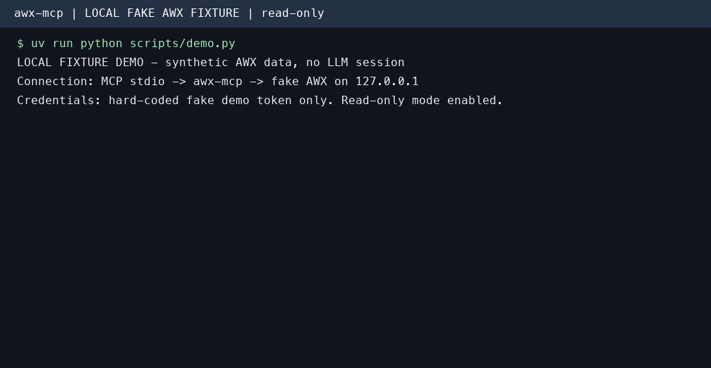

# AWX MCP Server

MCP 클라이언트에서 AWX의 실패한 작업과 실행 로그를 조회하고, 호출자의 AWX 권한으로 자동화를 관리할 수 있습니다. 개인용 stdio 프로세스로 실행하거나, 사용자별 토큰을 전달하는 중앙 서버로 공유할 수 있습니다.


[English](README.md) | [日本語](README.ja.md)

현재 Git 저장소에서 설치할 수 있으며 **PyPI에는 게시하지 않습니다**. 첫 release와 GHCR 이미지, MCP Registry 게시는 아직 진행하지 않았으므로 Release badge에는 release가 없다고 표시될 수 있습니다.

## 빠른 시작

먼저 uv를 설치하세요: https://docs.astral.sh/uv/

본인의 AWX URL과 토큰을 설정합니다. 아래 예시는 토큰을 명령어에 직접 넣지 않고 환경변수로 전달하며, 읽기 전용 모드로 시작합니다.

```bash
export ANSIBLE_BASE_URL="https://awx.example.com/"
export ANSIBLE_TOKEN="REPLACE_WITH_YOUR_AWX_TOKEN"
export AWX_MCP_READ_ONLY=true
claude mcp add --scope project awx \
  -e 'ANSIBLE_BASE_URL=${ANSIBLE_BASE_URL}' \
  -e 'ANSIBLE_TOKEN=${ANSIBLE_TOKEN}' \
  -e 'AWX_MCP_READ_ONLY=${AWX_MCP_READ_ONLY}' \
  -- uvx --from git+https://github.com/lycorp-jp/awx-mcp awx-mcp
```

`AWX_MCP_READ_ONLY=true`는 선택적인 시작 설정입니다. 쓰기 도구가 필요하고 AWX 역할에 권한이 있을 때 해제하세요. 서버 프로세스는 MCP 클라이언트가 실행하도록 설정합니다. Claude Desktop 등 다른 클라이언트의 설정은 [MCP 클라이언트 연동](#mcp-클라이언트-연동)을 참고하세요.

작은따옴표는 `.mcp.json`에 `${VAR}` 참조를 그대로 보관합니다. 해당 환경변수를 설정한 셸에서 Claude Code를 실행하세요. 환경변수 확장 안내: https://code.claude.com/docs/en/mcp#environment-variable-expansion-in-mcpjson

## 읽기 전용 fixture 데모



GIF는 로컬 fake AWX fixture에 실제 MCP `list_jobs(status="failed")`와 `get_job_stdout(job_id=42)`를 호출한 결과입니다. 데이터와 토큰은 모두 가짜입니다. 실제 AWX 운영 환경이나 LLM 대화를 촬영한 영상이 아니라 MCP 프로토콜 동작을 재현한 데모입니다.

[실행 기록](docs/demo.txt) · [재현 방법](docs/demo.tape)

## 목차

- [빠른 시작](#빠른-시작)
- [읽기 전용 fixture 데모](#읽기-전용-fixture-데모)
- [사전 요구사항](#사전-요구사항)
- [아키텍처](#아키텍처)
- [호환성](#호환성)
- [주요 기능](#주요-기능)
- [설치](#설치)
- [배포 모드](#배포-모드)
- [설정](#설정)
- [Credential Management (opt-in)](#credential-management-opt-in)
- [MCP 클라이언트 연동](#mcp-클라이언트-연동)
- [사용 예시](#사용-예시)
- [Resource와 runbook prompt](#resource와-runbook-prompt)
- [도구 목록](#도구-목록)
- [트러블슈팅](#트러블슈팅)
- [기여하기](#기여하기)
- [행동 강령](#행동-강령)
- [변경 이력](#변경-이력)
- [보안 정책](#보안-정책)
- [라이선스](#라이선스)

---

## 사전 요구사항

- 접근 가능한 AWX 인스턴스 및 해당 기본 URL (REST API v2), 그리고 적절한 권한이 있는 API 토큰 (또는 사용자명 + 비밀번호)
- uv: https://docs.astral.sh/uv/ (`uvx`를 제공하며, 클론 없이 git 저장소에서 바로 서버를 실행합니다)

---

## 아키텍처


> LLM이 사용자 요청을 분석하여 적절한 MCP 도구를 선택하고, AWX MCP 서버가 AWX REST API를 호출하여 결과를 반환합니다.

> 로컬 클라이언트에는 stdio를, 새 원격 배포에는 Streamable HTTP를 권장합니다. SSE는 기존 클라이언트의 호환성을 위한 legacy transport로 유지합니다(`--serve --sse`, `/sse`).

---

## 호환성

| 컴포넌트 | 지원 버전 |
|---------|---------|
| AWX | 24.6.1 (REST API v2) |
| Python | ≥ 3.10 |
| MCP transport | STDIO, SSE, Streamable HTTP |
| 서버 버전 | AWX와 독립적인 SemVer(`MAJOR.MINOR.PATCH`)를 사용하며 현재 개발 버전은 `1.0.0`입니다. 공개 인터페이스의 호환성을 깨는 변경은 MAJOR, 호환되는 기능 추가는 MINOR, 호환되는 수정은 PATCH를 올립니다. Release tag는 `vMAJOR.MINOR.PATCH` 형식이며, 개발 버전 표기가 tag의 존재를 뜻하지는 않습니다. |
| 다른 AWX / Ansible Tower 버전 | 이 호환성 표에서 검증했다고 주장하지 않습니다. 도입 전에 사용하는 인스턴스에서 확인하세요. |

---

## 주요 기능

| 기능 | 활용 효과 |
|------|-----------|
| AWX의 20개 영역을 지원하는 145개 도구 | 인벤토리, 작업, 워크플로우, 프로젝트, RBAC, 시스템 상태를 MCP 클라이언트 한 곳에서 조회할 수 있습니다. |
| 로컬 stdio와 중앙 `--serve` | 개인 프로세스로 실행하거나, 호출자별 AWX 토큰을 사용하는 공유 서버로 운영할 수 있습니다. |
| `AWX_MCP_READ_ONLY=true` | 서버 시작 시 읽기 도구만 노출합니다. AWX RBAC도 그대로 적용됩니다. |
| 이름 필터와 페이지네이션 | 이름으로 리소스를 찾고 클라이언트에 반환할 레코드 수를 제한할 수 있습니다. |
| 토큰 캐시 | 로컬에서 사용자명과 비밀번호로 인증하면 서버가 생성한 OAuth2 토큰을 재사용합니다. |
| TLS와 선택적 파일 로그 | 네트워크로 전달하는 자격 증명을 보호합니다. 중앙 서버는 호출자별 사용 로그와 HTTP 접속 JSONL을 stdout에 출력하며, 파일 로그를 추가로 설정할 수 있습니다. |

기본으로 141개 도구가 활성화됩니다. 자격 증명/사용자 쓰기 도구 4개는 명시적인 opt-in이 필요합니다. 다른 도구도 민감한 인벤토리 변수, 작업 출력, 계정 정보를 반환할 수 있습니다. 쓰기 기능을 켜기 전에 [Credential Management](#credential-management-opt-in)와 [보안 안내](docs/security.ko.md)를 확인하세요.

---

## 설치

패키지 배포의 기준은 GitHub입니다. 지금은 main branch를 사용하거나 `@<commit-sha-or-existing-ref>`를 붙여 실제로 존재하는 revision을 선택하세요. 첫 release 전에는 사용할 수 있는 release tag가 있다고 가정하지 않습니다.

```bash
uvx --from git+https://github.com/lycorp-jp/awx-mcp awx-mcp
```

`uvx`는 저장소를 가져와 빌드한 뒤 캐시합니다. 캐시된 main branch를 갱신하려면 한 번 `--refresh`를 추가하세요. 개발 환경에서는 `uv run --directory /path/to/awx-mcp awx-mcp --stdio`를 사용합니다. 해당 환경에서 `awx-mcp --version`으로 설치된 버전을 확인할 수 있습니다.

### Release 다운로드

안정 버전의 `vMAJOR.MINOR.PATCH` tag가 release 검증을 통과하면 GitHub Releases에 해당 CHANGELOG의 내용과 wheel(`.whl`), source distribution(`.tar.gz`), `release-notes.md`, `SHA256SUMS`가 게시됩니다. Python 패키지이므로 Python >= 3.10과 의존성 설치가 필요합니다. Fork는 자신의 Releases에 다운로드 파일을 게시하며, GHCR와 MCP Registry 게시는 upstream에서만 실행합니다. 자세한 절차는 [release 및 다운로드 안내](docs/releases.md)를 참고하세요. 다운로드 파일은 GitHub Release job이 성공한 뒤 사용할 수 있습니다.

### Docker / Podman

지금은 로컬 checkout에서 컨테이너를 빌드할 수 있습니다. 이미지의 기본 명령은 중앙 HTTP 서버이므로 아래 stdio 실행에서는 `--stdio`를 명시해야 합니다.

```bash
docker build -t awx-mcp:local .
docker run -i --rm -e ANSIBLE_BASE_URL -e ANSIBLE_TOKEN -e AWX_MCP_READ_ONLY awx-mcp:local --stdio
```

값은 환경변수로 전달하고, MCP stdio에는 `-t`를 사용하지 마세요. GHCR 이미지와 tag 설치 명령은 첫 release를 게시한 뒤 안내합니다. 다중 사용자 HTTP, 프록시, TLS, replica 구성은 [배포 안내](docs/deployment.ko.md)를 참고하세요.

---

## 배포 모드

| 명령 | 모드 | 인증 방식 |
|------|------|-----------|
| `awx-mcp` / `awx-mcp --stdio` | 로컬 stdio | 본인의 AWX 토큰 또는 사용자명/비밀번호 |
| `awx-mcp --remote <URL>` | 중앙 서버에 연결하는 로컬 프록시 | 본인의 AWX 토큰만 사용 |
| `awx-mcp --serve` | 중앙 Streamable HTTP 서버 | 요청마다 호출자의 토큰을 사용 |

중앙 서버는 정적으로 설정된 AWX 자격 증명을 무시합니다. 호출자 토큰을 TLS로 보호하고 네트워크 접근을 제한하세요. `--host`와 `--port`는 환경변수보다 우선합니다. [배포 예제, 직접 HTTP 연결, replica 구성](docs/deployment.ko.md)과 [TLS 및 로그](docs/security.ko.md)를 참고하세요.

### Toolset 선택과 읽기 전용 모드

`--toolsets jobs,job_templates` 또는 `AWX_MCP_TOOLSETS`로 노출할 도구를 선택합니다. CLI 옵션이 환경변수보다 우선하며 기본값은 `all`입니다. 알 수 없는 이름이나 빈 목록을 지정하면 시작 단계에서 실패합니다. `--serve`에서는 모든 호출자에게 같은 선택을 적용합니다. `--remote`에서는 일부 toolset 선택을 거부하므로 중앙 서버에서 설정해야 합니다.

`--read-only`와 `AWX_MCP_READ_ONLY=true` 중 하나라도 설정하면 읽기 전용 모드가 켜집니다. 로컬 서버와 중앙 서버에서는 읽기 도구만 노출합니다. 프록시는 `X-AWX-Read-Only: true`를 전달하여 해당 세션을 제한합니다. 기본 설정에서는 AWX RBAC가 허용하는 쓰기 작업을 포함해 141개 도구를 노출합니다.

```bash
awx-mcp --toolsets jobs,job_templates --read-only
```

<!-- TOOLSET_SUMMARY:BEGIN -->
<!-- Generated by scripts/gen_tool_docs.py. Do not edit by hand. -->

| Toolset | Default tools | With credential opt-in |
|---------|---------------|------------------------|
| `ad_hoc` | 3 | 3 |
| `credentials` | 5 | 7 |
| `execution_environments` | 5 | 5 |
| `groups` | 7 | 7 |
| `hosts` | 5 | 5 |
| `instances` | 4 | 4 |
| `inventories` | 14 | 14 |
| `job_templates` | 13 | 13 |
| `jobs` | 7 | 7 |
| `labels` | 2 | 2 |
| `notifications` | 3 | 3 |
| `organizations` | 5 | 5 |
| `projects` | 11 | 11 |
| `rbac` | 7 | 7 |
| `schedules` | 5 | 5 |
| `system` | 9 | 9 |
| `teams` | 5 | 5 |
| `users` | 3 | 5 |
| `workflow_jobs` | 11 | 11 |
| `workflow_templates` | 17 | 17 |
<!-- TOOLSET_SUMMARY:END -->

---

## 설정

환경변수로 AWX 접속 정보를 설정합니다. MCP 클라이언트 설정의 `env` 블록에 직접 넣으면 됩니다.

### 필수 환경 변수

| 변수 | 설명 | 예시 |
|------|------|------|
| `ANSIBLE_BASE_URL` | AWX 인스턴스 URL (끝 `/` 선택) | `https://awx.example.com` |

### 인증 (둘 중 하나 선택)

**방법 1: API 토큰 (권장)**

AWX UI에서 미리 생성한 토큰을 사용합니다. 토큰은 AWX 정책에 따라 만료되거나 폐기될 수 있습니다. 필요한 최소 권한과 scope를 선택하고, 필요할 때 교체하세요.

| 변수 | 설명 |
|------|------|
| `ANSIBLE_TOKEN` | 사전 생성된 API 토큰 |

> AWX UI에서 토큰 생성: 사용자 프로필 > 토큰 > 추가. 읽기 전용이면 Read scope를 선택하고, 쓰기가 필요할 때만 Write를 선택하세요. AWX RBAC도 접근 권한을 제한합니다.

**방법 2: 사용자명 + 비밀번호**

서버가 자동으로 OAuth2 토큰을 생성하고 캐시합니다.

| 변수 | 설명 |
|------|------|
| `ANSIBLE_USERNAME` | AWX 사용자명 |
| `ANSIBLE_PASSWORD` | AWX 비밀번호 |

### 선택 환경 변수

| 변수 | 기본값 | 설명 |
|------|--------|------|
| `ANSIBLE_SSL_VERIFY` | `true` | TLS 인증서 검증 (`true`/`false`). 검증은 **기본적으로 켜져 있습니다**. `false`로 설정하면 검증이 비활성화됩니다 (**보안 취약** - 경고가 로깅됩니다. CA 번들이 없는 개발/자체 서명 환경에서만 사용하세요). |
| `ANSIBLE_CA_BUNDLE` | 미설정 | 검증이 활성화된 상태에서 신뢰할 커스텀 CA 번들/자체 서명 인증서(PEM) 경로. 검증을 끄지 않고도 사설 CA를 사용하는 AWX 인스턴스에 연결할 수 있습니다. 경로가 존재하지 않으면 서버가 시작 시 즉시 실패합니다. |
| `ANSIBLE_LOG_LEVEL` | `INFO` | 로그 레벨 (`DEBUG`, `INFO`, `WARNING`, `ERROR`) |
| `AWX_HTTP_TIMEOUT_READ` | `90` | AWX API 요청 하나의 읽기 timeout(초). 느린 AWX 에서 큰 `get_job_stdout` / `get_job_events` 호출이 timeout 나면 늘린다. |
| `AWX_MCP_ENABLE_CREDENTIAL_MANAGEMENT` | `false` | Form mode elicitation으로 민감 데이터를 수집하는 자격 증명/사용자 쓰기 도구 4개의 활성화 여부. [Credential Management (opt-in)](#credential-management-opt-in) 섹션 참조. |
| `AWX_MCP_TOOLSETS` | `all` | 도구 모듈 이름을 쉼표로 구분합니다. `--toolsets`가 우선합니다. `--serve`에서는 서버 전체에 적용하며, `--remote`에서는 일부 toolset 선택을 거부합니다. |
| `AWX_MCP_READ_ONLY` | `false` | 읽기 전용 모드. `--serve` 중앙 서버에서 `true`로 설정하면 모든 쓰기/파괴적 도구가 전역적으로 등록 해제됩니다(사용자가 다시 켤 수 없음). `--remote` 프록시 모드에서 `true`는 해당 사용자의 세션에만 적용됩니다(프록시가 `X-AWX-Read-Only`를 전송하고, 서버는 그 호출자의 쓰기 호출만 거부합니다). 어드바이저리 성격의 자기 제한이며 - [배포 모드](docs/deployment.ko.md) 참조. |
| `AWX_MCP_REMOTE_URL` | 미설정 | 프록시 모드용 중앙 서버 URL(`--remote <URL>`과 동등하며, 플래그가 우선합니다). |
| `AWX_MCP_HOST` | `127.0.0.1` | `--serve` 서버의 바인드 호스트. `--host`로 오버라이드됩니다. |
| `AWX_MCP_PORT` | `8000` | `--serve` 서버의 바인드 포트. `--port`로 오버라이드됩니다. |
| `AWX_MCP_TLS_ENABLE` | `false` | `true`로 설정하면 `--serve` 서버가 프로세스 내에서 HTTPS로 서빙합니다 (uvicorn). 호출자 토큰이 요청 헤더로 전달되므로 강력히 권장됩니다. |
| `AWX_MCP_TLS_CERT` | 미설정 | 서버 TLS 인증서(PEM) 경로. `AWX_MCP_TLS_ENABLE=true`일 때 필수이며, 경로가 없거나 찾을 수 없으면 서버가 시작 시 즉시 실패합니다. |
| `AWX_MCP_TLS_KEY` | 미설정 | 서버 TLS 개인 키(PEM) 경로. TLS가 활성화되면 필수입니다. |
| `AWX_MCP_TLS_KEY_PASSWORD` | 미설정 | 개인 키가 암호화된 경우의 비밀번호. 선택 사항. |
| `AWX_MCP_STATELESS_HTTP` | `false` | 상태 비저장(stateless) streamable-http 모드. 각 요청이 그 자체로 완결되어 프로세스에 세션별 상태를 유지하지 않습니다. 단순 라운드로빈 로드밸런서 뒤에 여러 `--serve` replica를 운영할 때 필요합니다(그렇지 않으면 한 replica에서 만든 세션이 다른 replica로 라우팅될 때 404가 발생합니다). 기본값(off)은 단일 인스턴스/sse 구성의 상태 유지(stateful) 세션 동작을 그대로 유지합니다. |
| `AWX_MCP_USAGE_LOG_FILE` | 미설정 | `--remote` 프록시를 포함한 모든 모드에서 선택적으로 설정하는 JSON Lines 사용 로그 파일 경로이며, 파일은 주기적으로 회전합니다. MCP 도구 호출마다 하나의 JSON 문서(`@timestamp`, `type`, `user`, `tool`, `params`(마스킹된 호출 인자), `trace_id`, `server_version`, `success`, `latency_ms`, `auth_mode`, `transport`, `awx_host`, 실패 시 `error{type,message}`)가 기록됩니다. 중앙 `--serve` 모드(`streamable-http` 또는 `sse`)에서는 도구와 내부 API 사용 기록을 항상 stdout에 출력하며, 이 경로는 파일 출력을 추가합니다. 경로 미설정으로 사용 로그가 비활성화되는 범위는 로컬 stdio와 프록시 모드뿐입니다. [상세 사용 로그](docs/security.ko.md#상세-사용-로그)를 참고하세요. |
| `AWX_MCP_USAGE_USER` | 미설정 | 프록시의 로컬 사용 로그에서 `user` 필드로 사용할 레이블(선택 사항). 프록시 모드는 사용자명을 조회할 AWX 접근 권한이 없으므로 기본값은 `local`입니다. |
| `AWX_MCP_ACCESS_LOG_FILE` | 미설정 | `--serve` 서버에서 선택적으로 추가하는 JSON Lines 접속(access) 로그 파일 경로입니다. 이 경로를 설정하지 않아도 들어오는 모든 HTTP 요청은 stdout에 기록됩니다(클라이언트 IP, 메서드, 경로, 상태 코드, 지연시간). 파일은 사용 로그와 마찬가지로 매일 자정(UTC)에 회전합니다. `--serve` 모드에서만 동작하며, 로컬 stdio와 `--remote` 프록시에는 인바운드 HTTP 소켓이 없습니다. |
| `AWX_MCP_SERVER_LOG_FILE` | 미설정 | 서버 진단 로그 파일 경로. 기존 stderr 진단/에러 출력을 그대로 파일에도 기록합니다. 미설정 시 stderr에만 출력되고 파일은 생성되지 않습니다. |
| `AWX_MCP_SERVER_LOG_FORMAT` | `plain` | 서버 진단 로그 형식: `plain` 또는 `json`. |
| `AWX_MCP_LOG_BACKUP_COUNT` | `7` | 로테이션된 로그 파일 보관 개수. 두 로그 파일 모두 매일 자정(UTC)에 날짜 접미사를 붙여 로테이션됩니다. |

### TLS / 인증서 검증

TLS 인증서 검증은 기본적으로 활성화됩니다. 사설 CA는 `ANSIBLE_CA_BUNDLE`로 신뢰하도록 설정하세요. `--remote`에서는 이 검증 설정이 AWX가 아닌 중앙 서버에 적용됩니다. 네트워크에 노출하는 중앙 서버에는 TLS와 접근 제한이 필요합니다. 중앙 `--serve` 모드(`streamable-http` 또는 `sse`)는 사용/접속 JSONL을 항상 stdout에 출력합니다. 파일 설정은 주기적으로 회전하는 파일 출력을 추가하며 stdout 출력을 끄지 않습니다. 로컬 stdio와 `--remote` 프록시에서는 stdout을 MCP 메시지 전용으로 사용하고, 사용 파일 로그는 경로를 설정한 경우에만 기록합니다. 진단 로그는 기본적으로 stderr에 출력됩니다. 컨테이너나 플랫폼의 로그 수집기는 stdout/stderr를 수집할 수 있습니다. [TLS, 로그 필드, 마스킹 한계, replica 주의사항](docs/security.ko.md)을 참고하세요.

---

## Credential Management (opt-in)

`create_credential`, `update_credential`, `create_user`, `update_user`는 **Form mode elicitation**으로 비밀번호나 자격 증명 입력을 수집하므로 기본적으로 등록하지 않습니다. 나머지 도구도 작업 stdout이나 인벤토리 변수처럼 민감한 리소스 데이터를 반환할 수 있습니다.

활성화하려면 다음을 설정하세요:

```bash
AWX_MCP_ENABLE_CREDENTIAL_MANAGEMENT=true
```

Form mode elicitation은 MCP 스펙 관점에서 민감 데이터에 대해 비준수 상태입니다 - 응답이 클라이언트 측 로깅이나 기타 중간 시스템을 통해 노출될 수 있습니다. 신뢰할 수 있는 격리된 환경에서만 활성화하고, `--serve`와 **함께 사용하지 마세요**(공유 네트워크 배포는 로컬 stdio 프로세스보다 상황을 더 악화시킵니다). 전체 위협 모델 및 공개 정책은 [SECURITY.md](./SECURITY.md)를 참고하세요.

---

## MCP 클라이언트 연동

### Claude Desktop

`claude_desktop_config.json`에 다음을 추가합니다:

```json
{
  "mcpServers": {
    "awx": {
      "command": "uvx",
      "args": ["--from", "git+https://github.com/lycorp-jp/awx-mcp", "awx-mcp"],
      "env": {
        "ANSIBLE_BASE_URL": "https://awx.example.com/",
        "ANSIBLE_TOKEN": "your_api_token"
      }
    }
  }
}
```

### Claude Code (CLI)

```bash
claude mcp add awx \
  -e ANSIBLE_BASE_URL=https://awx.example.com/ \
  -e ANSIBLE_TOKEN=your_api_token \
  -- uvx --from git+https://github.com/lycorp-jp/awx-mcp awx-mcp
```

### Cursor

아래 설치 링크는 **읽기 전용 설정 틀**을 추가합니다. 연결 설정이 완료되는 것은 아닙니다. 실행 전에 Cursor MCP 설정에서 `REPLACE_WITH_YOUR_AWX_HTTPS_URL`과 `REPLACE_WITH_YOUR_AWX_TOKEN`을 **모두 교체하세요**. 이 설정을 version control에 포함하지 마세요.

cursor://anysphere.cursor-deeplink/mcp/install?name=awx&config=eyJjb21tYW5kIjoidXZ4IiwiYXJncyI6WyItLWZyb20iLCJnaXQraHR0cHM6Ly9naXRodWIuY29tL2x5Y29ycC1qcC9hd3gtbWNwIiwiYXd4LW1jcCJdLCJlbnYiOnsiQU5TSUJMRV9CQVNFX1VSTCI6IlJFUExBQ0VfV0lUSF9ZT1VSX0FXWF9IVFRQU19VUkwiLCJBTlNJQkxFX1RPS0VOIjoiUkVQTEFDRV9XSVRIX1lPVVJfQVdYX1RPS0VOIiwiQVdYX01DUF9SRUFEX09OTFkiOiJ0cnVlIn19

공식 형식: https://cursor.com/docs/mcp/install-links

### VS Code (native MCP)

`.vscode/mcp.json`이나 사용자 MCP 설정에 아래 내용을 추가합니다. VS Code가 URL과 토큰을 입력받으며 토큰 입력은 가려집니다. `env`의 참조는 아래 `inputs`에 연결됩니다.

```json
{
  "inputs": [
    {
      "id": "awx-url",
      "type": "promptString",
      "description": "AWX HTTPS 기본 URL"
    },
    {
      "id": "awx-token",
      "type": "promptString",
      "description": "AWX API 토큰",
      "password": true
    }
  ],
  "servers": {
    "awx": {
      "type": "stdio",
      "command": "uvx",
      "args": [
        "--from",
        "git+https://github.com/lycorp-jp/awx-mcp",
        "awx-mcp"
      ],
      "env": {
        "ANSIBLE_BASE_URL": "${input:awx-url}",
        "ANSIBLE_TOKEN": "${input:awx-token}",
        "AWX_MCP_READ_ONLY": "true"
      }
    }
  }
}
```

설정 안내: https://code.visualstudio.com/docs/agents/reference/mcp-configuration

### Cline (VS Code)

MCP 서버 설정에 다음을 추가합니다:

```json
{
  "awx": {
    "command": "uvx",
    "args": ["--from", "git+https://github.com/lycorp-jp/awx-mcp", "awx-mcp"],
    "env": {
      "ANSIBLE_BASE_URL": "https://awx.example.com/",
      "ANSIBLE_TOKEN": "your_api_token"
    }
  }
}
```

### 중앙 서버 접속

본인의 AWX 토큰으로 stdio 프록시 또는 직접 Streamable HTTP 연결을 사용합니다. 프록시에는 `ANSIBLE_TOKEN`이 필요하며 `ANSIBLE_BASE_URL`은 필요하지 않습니다. 사용자명/비밀번호 인증은 로컬 모드에서만 지원합니다. [전체 프록시/직접 HTTP 설정과 TLS 요구사항](docs/deployment.ko.md)을 참고하세요.

---

## 사용 예시

MCP 클라이언트(Claude 등)에 자연어로 요청하면 서버가 적절한 도구를 호출합니다.

### 인벤토리 관리

```
"Production 인벤토리의 호스트 목록을 보여줘"
→ list_hosts(inventory_id=1) 호출

"web-server-01 호스트를 Production 인벤토리에 추가해줘"
→ create_host(name="web-server-01", inventory_id=1) 호출

"DB 서버들을 database 그룹으로 묶어줘"
→ create_group(...) + add_host_to_group(...) 호출
```

### 작업 실행 및 모니터링

```
"Deploy App 작업 템플릿을 실행해줘"
→ launch_job(template_id=5) 호출

"방금 실행한 작업의 진행 상황을 확인해줘"
→ get_job(job_id=123) 호출

"작업 실행 로그를 보여줘"
→ get_job_stdout(job_id=123) 호출

"실패한 작업을 재실행해줘"
→ relaunch_job(job_id=123) 호출
```

### 프로젝트 & SCM

```
"모든 프로젝트를 최신 상태로 동기화해줘"
→ list_projects() + sync_project(project_id=...) 반복 호출

"my-project에 있는 플레이북 목록을 보여줘"
→ list_project_playbooks(project_id=3) 호출
```

### 워크플로우

```
"배포 워크플로우를 실행하고 승인이 필요하면 승인해줘"
→ launch_workflow(template_id=10) 호출
→ list_workflow_approvals() → approve_workflow(approval_id=...) 호출

"워크플로우 실행 결과에서 실패한 노드를 확인해줘"
→ list_workflow_job_nodes(workflow_job_id=50) 호출
```

### RBAC & 사용자 관리

```
"developer 팀에 Production 인벤토리 읽기 권한을 부여해줘"
→ list_object_roles(...) + grant_role_to_team(role_id=..., team_id=...) 호출

"새 사용자 john을 생성하고 DevOps 팀에 추가해줘"
→ create_user(...) + grant_role_to_user(...) 호출
```

### 시스템 관리

```
"AWX 버전과 클러스터 상태를 확인해줘"
→ get_ansible_version() + list_instances() 호출

"90일 이전의 오래된 작업 기록을 정리해줘"
→ list_system_job_templates() → launch_system_job(template_id=..., extra_vars='{"days": 90}') 호출
```

---

## Resource와 runbook prompt

로컬 stdio, 중앙 HTTP/SSE 서버, stdio proxy에서 같은 읽기 전용 resource와 runbook prompt를 제공합니다. Toolset을 선택하면 해당 capability도 함께 필터링합니다. 읽기 전용 모드에서도 사용할 수 있습니다. 중앙 서버가 resource를 읽을 때는 각 요청의 호출자 토큰과 AWX 권한을 적용하며, 서버의 자격 증명으로 대체하지 않습니다.

`resources/templates/list`에서 URI template 5개를 확인하고, 읽기 도구로 조회한 ID를 넣어 사용하세요. 각 resource는 ID로 지정하므로 `resources/list`는 빈 목록을 반환합니다.

| URI template | 내용 | 필요한 toolset |
|---|---|---|
| `awx://jobs/{id}` | Job 상세 정보, `application/json` | `jobs` |
| `awx://jobs/{id}/stdout` | Job 실행 출력, `text/plain` | `jobs` |
| `awx://inventories/{id}` | Inventory 상세 정보, `application/json` | `inventories` |
| `awx://inventory-sources/{id}` | Inventory source 상세 정보, `application/json` | `inventories` |
| `awx://projects/{id}` | Project 상세 정보, `application/json` | `projects` |

Runbook은 `prompts/list`와 `prompts/get`으로 조회합니다. 필요한 toolset을 모두 활성화한 경우에만 해당 prompt를 노출합니다. Prompt를 생성할 때는 AWX를 호출하지 않습니다. 생성된 지침은 읽기 점검 절차를 안내하며, 모든 쓰기 작업 전에 사용자의 명시적인 확인을 요구합니다.

| Prompt | 필수 인자 | 읽기 점검 절차 | 필요한 toolset |
|---|---|---|---|
| `failed_job_triage` | `job_id` | 상태, stdout, event, host별 결과를 확인합니다 | `jobs` |
| `pre_change_inventory_check` | `inventory_id` | Inventory, host, group, source 상태를 확인합니다 | `inventories`, `hosts`, `groups` |
| `project_sync_review` | `project_id` | SCM revision, sync 이력, 로그, playbook을 확인합니다 | `projects` |

초기화한 Python MCP `ClientSession`에서 다음과 같이 호출합니다.

```python
await session.read_resource("awx://jobs/42/stdout")
await session.get_prompt("failed_job_triage", {"job_id": "42"})
```

Proxy는 upstream의 pagination, resource 내용과 metadata를 보존합니다. Resource 구독과 변경 알림은 중계하지 않습니다.

## 도구 목록

총 **145개** 도구를 20개 모듈로 제공합니다. 기본값으로 141개가 등록되며, 아래에서 **opt-in**으로 표시된 4개는 `AWX_MCP_ENABLE_CREDENTIAL_MANAGEMENT=true` 설정 시에만 노출됩니다([Credential Management (opt-in)](#credential-management-opt-in) 섹션 참조).

### 이름으로 검색하기

이름을 가진 컬렉션을 다루는 모든 `list_*` 도구는 이름 인자를 선택적으로 받습니다.
AWX가 이를 **서버 사이드**에서 대소문자 구분 없는 부분 일치로 적용하므로, 컬렉션을
페이지 단위로 훑지 않고 한 번의 호출로 이름을 ID로 해석할 수 있습니다.

```
list_job_templates(template_name="deploy")      -> "deploy"와 일치하는 템플릿만
list_projects(project_name="platform")          -> "platform"과 일치하는 프로젝트만
```

인자 이름은 리소스에 따라 정해집니다(`project_name`, `inventory_name`,
`credential_name` 등). `list_hosts`와 `list_instances`는 `hostname`,
`list_users`는 `username`을 사용합니다. 인자를 생략하면 기존과 동일하게 전체를
조회합니다.

이름 필터가 없는 두 부류가 있습니다. `list_roles`는 AWX가 역할 이름을 저장하지 않고
role 필드에서 파생시키기 때문에 필터링할 수 없습니다. 실행 기록 조회
(`list_jobs`, `list_project_updates` 등)는 이름 대신 상태와 상위 템플릿으로
조회합니다.

<details>
<summary><strong>전체 145개 도구 보기</strong></summary>

<!-- TOOL_TABLES:BEGIN -->
<!-- Generated by scripts/gen_tool_docs.py. Do not edit by hand. -->

### `ad_hoc` (3 tools, 3 default)

| Tool | Access | Summary |
|------|--------|---------|
| `cancel_ad_hoc_command` | Write | Cancel a running AWX ad hoc command. |
| `get_ad_hoc_command` | Read | Get details for one AWX ad hoc command. |
| `run_ad_hoc_command` | Write | Run an AWX ad hoc command. |

### `credentials` (7 tools, 5 default)

| Tool | Access | Summary |
|------|--------|---------|
| `copy_credential` | Write | Copy an AWX credential. |
| `create_credential` | Write (opt-in) | Create an AWX credential. |
| `delete_credential` | Write | Delete an AWX credential. |
| `get_credential` | Read | Get details for one AWX credential. |
| `list_credential_types` | Read | List AWX credential types. |
| `list_credentials` | Read | List AWX credentials. |
| `update_credential` | Write (opt-in) | Update AWX credential metadata or inputs. |

### `execution_environments` (5 tools, 5 default)

| Tool | Access | Summary |
|------|--------|---------|
| `create_execution_environment` | Write | Create an AWX execution environment. |
| `delete_execution_environment` | Write | Delete an AWX execution environment. |
| `get_execution_environment` | Read | Get details for one AWX execution environment. |
| `list_execution_environments` | Read | List AWX execution environments. |
| `update_execution_environment` | Write | Update an AWX execution environment. |

### `groups` (7 tools, 7 default)

| Tool | Access | Summary |
|------|--------|---------|
| `add_host_to_group` | Write | Associate an existing AWX host with a group. |
| `create_group` | Write | Create an AWX group inside an inventory. |
| `delete_group` | Write | Delete an AWX group. |
| `get_group` | Read | Get details for one AWX group. |
| `list_groups` | Read | List AWX inventory groups. |
| `remove_host_from_group` | Write | Remove AWX host membership from a group. |
| `update_group` | Write | Update AWX group metadata and variables. |

### `hosts` (5 tools, 5 default)

| Tool | Access | Summary |
|------|--------|---------|
| `create_host` | Write | Create an AWX host in an inventory. |
| `delete_host` | Write | Delete an AWX host. |
| `get_host` | Read | Get details for one AWX host. |
| `list_hosts` | Read | List AWX hosts. |
| `update_host` | Write | Update AWX host metadata and variables. |

### `instances` (4 tools, 4 default)

| Tool | Access | Summary |
|------|--------|---------|
| `get_instance` | Read | Get details for one AWX cluster instance. |
| `get_instance_group` | Read | Get details for one AWX instance group. |
| `list_instance_groups` | Read | List AWX instance groups. |
| `list_instances` | Read | List AWX cluster instances. |

### `inventories` (14 tools, 14 default)

| Tool | Access | Summary |
|------|--------|---------|
| `cancel_inventory_update` | Write | Cancel a running AWX inventory update. |
| `create_inventory` | Write | Create an AWX inventory in an organization. |
| `create_inventory_source` | Write | Create an AWX inventory source for dynamic host sync. |
| `delete_inventory` | Write | Delete an AWX inventory. |
| `delete_inventory_source` | Write | Delete an AWX inventory source. |
| `get_inventory` | Read | Get details for one AWX inventory. |
| `get_inventory_source` | Read | Get details for one AWX inventory source. |
| `get_inventory_update` | Read | Get details for one AWX inventory update. |
| `list_inventories` | Read | List AWX inventories. |
| `list_inventory_sources` | Read | List AWX inventory sources. |
| `list_inventory_updates` | Read | List AWX inventory source sync history. |
| `sync_inventory_source` | Write | Start an AWX inventory source sync. |
| `update_inventory` | Write | Update AWX inventory metadata. |
| `update_inventory_source` | Write | Update an existing AWX inventory source. |

### `job_templates` (13 tools, 13 default)

| Tool | Access | Summary |
|------|--------|---------|
| `associate_credential_with_template` | Write | Associate a credential with an AWX job template. |
| `copy_job_template` | Write | Create a copy of an AWX job template. |
| `create_job_template` | Write | Create an AWX job template for single playbook execution. |
| `delete_job_template` | Write | Delete an AWX job template. |
| `delete_job_template_survey` | Write | Delete the survey spec from an AWX job template. |
| `disassociate_credential_from_template` | Write | Disassociate a credential from an AWX job template. |
| `get_job_template` | Read | Get details for a specific AWX job template. |
| `get_job_template_survey` | Read | Get the survey spec for an AWX job template. |
| `launch_job` | Write | Launch a single AWX playbook execution from a job template. |
| `list_job_templates` | Read | List AWX job templates for single playbook executions. |
| `list_template_credentials` | Read | List credentials attached to an AWX job template. |
| `set_job_template_survey` | Write | Set the survey spec for an AWX job template. |
| `update_job_template` | Write | Update an existing AWX job template. |

### `jobs` (7 tools, 7 default)

| Tool | Access | Summary |
|------|--------|---------|
| `cancel_job` | Write | Cancel a running AWX regular playbook job. |
| `get_job` | Read | Get details for a single AWX playbook execution job. |
| `get_job_events` | Read | Get event stream records for a specific AWX regular job. |
| `get_job_host_summaries` | Read | Get AWX per-host result summaries for a regular playbook job. |
| `get_job_stdout` | Read | Get stdout logs for a specific AWX regular playbook job. |
| `list_jobs` | Read | List AWX regular playbook jobs, optionally filtered by status. |
| `relaunch_job` | Write | Relaunch a completed or failed AWX regular playbook job. |

### `labels` (2 tools, 2 default)

| Tool | Access | Summary |
|------|--------|---------|
| `create_label` | Write | Create an AWX label in an organization. |
| `list_labels` | Read | List AWX labels. |

### `notifications` (3 tools, 3 default)

| Tool | Access | Summary |
|------|--------|---------|
| `get_notification_template` | Read | Get details for one AWX notification template. |
| `list_notification_templates` | Read | List AWX notification templates. |
| `test_notification_template` | Write | Send a test event through an AWX notification template. |

### `organizations` (5 tools, 5 default)

| Tool | Access | Summary |
|------|--------|---------|
| `create_organization` | Write | Create an AWX organization. |
| `delete_organization` | Write | Delete an AWX organization. |
| `get_organization` | Read | Get details for one AWX organization. |
| `list_organizations` | Read | List AWX organizations. |
| `update_organization` | Write | Update an AWX organization. |

### `projects` (11 tools, 11 default)

| Tool | Access | Summary |
|------|--------|---------|
| `cancel_project_update` | Write | Cancel a running AWX project update. |
| `create_project` | Write | Create an AWX project for playbook content. |
| `delete_project` | Write | Delete an AWX project. |
| `get_project` | Read | Get details for one AWX project. |
| `get_project_update` | Read | Get details for one AWX project update. |
| `get_project_update_stdout` | Read | Get AWX stdout logs for a project update. |
| `list_project_playbooks` | Read | List AWX playbooks discovered in a project. |
| `list_project_updates` | Read | List AWX project SCM sync history. |
| `list_projects` | Read | List AWX projects. |
| `sync_project` | Write | Start an AWX project SCM sync. |
| `update_project` | Write | Update AWX project metadata and SCM settings. |

### `rbac` (7 tools, 7 default)

| Tool | Access | Summary |
|------|--------|---------|
| `get_role` | Read | Get details for one AWX RBAC role. |
| `grant_role_to_team` | Write | Grant an AWX role to a team. |
| `grant_role_to_user` | Write | Grant an AWX role to a user. |
| `list_object_roles` | Read | List AWX RBAC roles for one specific resource. |
| `list_roles` | Read | List all AWX RBAC roles. |
| `revoke_role_from_team` | Write | Revoke an AWX role from a team. |
| `revoke_role_from_user` | Write | Revoke an AWX role from a user. |

### `schedules` (5 tools, 5 default)

| Tool | Access | Summary |
|------|--------|---------|
| `create_schedule` | Write | Create an AWX schedule for recurring launches. |
| `delete_schedule` | Write | Delete an AWX schedule. |
| `get_schedule` | Read | Get details for one AWX schedule. |
| `list_schedules` | Read | List AWX schedules, optionally filtered by template. |
| `update_schedule` | Write | Update an AWX schedule. |

### `system` (9 tools, 9 default)

| Tool | Access | Summary |
|------|--------|---------|
| `get_ansible_version` | Read | Get AWX/Ansible controller version and health information. |
| `get_config` | Read | Get AWX instance configuration metadata. |
| `get_dashboard_stats` | Read | Get AWX dashboard summary statistics. |
| `get_system_job` | Read | Get details for a specific AWX maintenance system job run. |
| `get_system_job_template` | Read | Get details for a specific AWX system job template. |
| `launch_system_job` | Write | Launch an AWX maintenance system job from a system job template. |
| `list_activity_stream` | Read | List AWX activity stream audit entries. |
| `list_system_job_templates` | Read | List AWX system job templates for maintenance operations. |
| `list_system_jobs` | Read | List AWX system job executions. |

### `teams` (5 tools, 5 default)

| Tool | Access | Summary |
|------|--------|---------|
| `create_team` | Write | Create an AWX team within an organization. |
| `delete_team` | Write | Delete an AWX team. |
| `get_team` | Read | Get details for one AWX team. |
| `list_teams` | Read | List AWX teams, optionally scoped to an organization. |
| `update_team` | Write | Update an AWX team. |

### `users` (5 tools, 3 default)

| Tool | Access | Summary |
|------|--------|---------|
| `create_user` | Write (opt-in) | Create an AWX user account. |
| `delete_user` | Write | Delete an AWX user account. |
| `get_user` | Read | Get details for one AWX user. |
| `list_users` | Read | List AWX users. |
| `update_user` | Write (opt-in) | Update an AWX user account. |

### `workflow_jobs` (11 tools, 11 default)

| Tool | Access | Summary |
|------|--------|---------|
| `approve_workflow` | Write | Approve a pending AWX workflow approval request. |
| `cancel_workflow_job` | Write | Cancel a running AWX workflow orchestration run. |
| `deny_workflow` | Write | Deny a pending AWX workflow approval request. |
| `get_workflow_approval` | Read | Get details for a specific AWX workflow approval request. |
| `get_workflow_approval_template` | Read | Get a workflow job template node by ID (may or may not be an approval node). |
| `get_workflow_job` | Read | Get details for a single AWX workflow orchestration run. |
| `list_workflow_approval_templates` | Read | List AWX workflow approval template nodes. |
| `list_workflow_approvals` | Read | List AWX workflow approval requests, optionally filtered by status. |
| `list_workflow_job_nodes` | Read | List node outcomes for an executed AWX workflow job. |
| `list_workflow_jobs` | Read | List AWX workflow orchestration runs, optionally filtered by status. |
| `relaunch_workflow_job` | Write | Relaunch a completed or failed AWX workflow orchestration run. |

### `workflow_templates` (17 tools, 17 default)

| Tool | Access | Summary |
|------|--------|---------|
| `add_workflow_node_always_link` | Write | Add an AWX workflow always-run edge between template nodes. |
| `add_workflow_node_failure_link` | Write | Add an AWX workflow failure edge between template nodes. |
| `add_workflow_node_success_link` | Write | Add an AWX workflow success edge between template nodes. |
| `copy_workflow_template` | Write | Create a copy of an AWX workflow template. |
| `create_workflow_template` | Write | Create an AWX workflow template for multi-step orchestration. |
| `create_workflow_template_node` | Write | Create a node in an AWX workflow template. |
| `delete_workflow_template` | Write | Delete an AWX workflow template. |
| `delete_workflow_template_node` | Write | Delete an AWX workflow template node. |
| `delete_workflow_template_survey` | Write | Delete the survey spec from an AWX workflow template. |
| `get_workflow_template` | Read | Get details for a specific AWX workflow template. |
| `get_workflow_template_node` | Read | Get details for a specific AWX workflow template node. |
| `get_workflow_template_survey` | Read | Get the survey spec for an AWX workflow template. |
| `launch_workflow` | Write | Launch an AWX multi-step workflow from a workflow template. |
| `list_workflow_template_nodes` | Read | List nodes defined in an AWX workflow template. |
| `list_workflow_templates` | Read | List AWX workflow templates for multi-step orchestration. |
| `set_workflow_template_survey` | Write | Set the survey spec for an AWX workflow template. |
| `update_workflow_template` | Write | Update an existing AWX workflow template. |
<!-- TOOL_TABLES:END -->

</details>

---

## 트러블슈팅

### 서버가 시작되지 않아요

**`ValueError: ANSIBLE_BASE_URL environment variable is required`**

환경변수가 설정되지 않았습니다. MCP 클라이언트 설정의 `env` 블록에 `ANSIBLE_BASE_URL`을 추가하세요.

**`ValueError: Authentication is required`**

`ANSIBLE_TOKEN` 또는 `ANSIBLE_USERNAME` + `ANSIBLE_PASSWORD` 중 하나를 설정해야 합니다.

### 연결이 안 돼요

**SSL 인증서 오류**

TLS 검증은 기본적으로 켜져 있습니다. AWX 인스턴스가 사설/내부 CA가 발급한 인증서 또는 자체 서명 인증서를 사용한다면, `ANSIBLE_CA_BUNDLE`에 해당 CA/인증서의 PEM 파일 경로를 설정하세요. 검증을 켠 채로 그 인증서를 신뢰할 수 있습니다. CA 인증서를 구할 수 없는 등 최후의 수단으로만 `ANSIBLE_SSL_VERIFY`를 `"false"`(반드시 문자열)로 설정하세요. 이 경우 검증이 완전히 비활성화되며 서버가 경고를 로깅합니다. 자세한 내용은 [TLS 인증서 검증](docs/security.ko.md#tls--인증서-검증)을 참고하세요.

**Connection refused / timeout**

- `ANSIBLE_BASE_URL`이 정확한지 확인하세요
- AWX 인스턴스가 실행 중인지 확인하세요
- 방화벽/네트워크 설정을 확인하세요

### MCP 스키마 오류

**`Does not adhere to MCP server configuration schema`**

`env` 블록의 모든 값은 **문자열**이어야 합니다. `false` (boolean) 대신 `"false"` (문자열)을 사용하세요.

### 권한 오류

**403 Forbidden**

API 토큰 또는 사용자 계정에 해당 리소스에 대한 권한이 없습니다. AWX 관리자에게 적절한 역할을 요청하세요.

### 디버깅

로그 레벨을 `DEBUG`로 설정하면 상세한 API 요청/응답 로그를 확인할 수 있습니다:

```json
"ANSIBLE_LOG_LEVEL": "DEBUG"
```

---

## 기여하기

기여를 환영합니다. 이슈 제출, 변경 제안, PR 오픈 방법은 [CONTRIBUTING.md](CONTRIBUTING.md)를 참고하세요.

## 행동 강령

이 프로젝트는 [행동 강령](CODE_OF_CONDUCT.md)을 따릅니다. 참여 시 해당 조항을 준수해야 합니다.

## 변경 이력

주요 변경 사항의 이력은 [CHANGELOG.md](CHANGELOG.md)를 참조하세요.

## 보안 정책

취약점 공개, 위협 모델, 보안 이력은 [SECURITY.md](SECURITY.md)를 참조하세요.

---

## 라이선스

Apache License 2.0 - 자세한 내용은 [LICENSE](LICENSE) 파일을 참조하세요.
