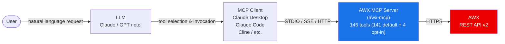

# AWX MCP Server

Connect your MCP client to AWX to inspect failed jobs, read execution logs, and manage automation with the caller’s AWX permissions. Run locally over stdio or share a central server with per-user token passthrough.


[한국어](README.ko.md) | [日本語](README.ja.md)

Git installation is available now. This package is **not on PyPI**. The first release, GHCR image, and MCP Registry publication are pending, so the Release badge may show no release.

## Quick Start

Install uv first: https://docs.astral.sh/uv/

Use your own AWX URL and token. The following read-only setup uses environment variables instead of embedding a token in the command.

```bash
export ANSIBLE_BASE_URL="https://awx.example.com/"
export ANSIBLE_TOKEN="REPLACE_WITH_YOUR_AWX_TOKEN"
export AWX_MCP_READ_ONLY=true
claude mcp add --scope project awx \
  -e 'ANSIBLE_BASE_URL=${ANSIBLE_BASE_URL}' \
  -e 'ANSIBLE_TOKEN=${ANSIBLE_TOKEN}' \
  -e 'AWX_MCP_READ_ONLY=${AWX_MCP_READ_ONLY}' \
  -- uvx --from git+https://github.com/lycorp-jp/awx-mcp awx-mcp
```

`AWX_MCP_READ_ONLY=true` is an optional starting point. Remove it only when you need write tools and your AWX role permits the operation. Let the MCP client launch the server. Claude Desktop and other clients are covered in [MCP Client Integration](#mcp-client-integration).

The single quotes keep `${VAR}` references in `.mcp.json`. Start Claude Code from a shell with those variables set. Environment expansion: https://code.claude.com/docs/en/mcp#environment-variable-expansion-in-mcpjson

## Read-only fixture demo


The GIF shows actual MCP `list_jobs(status="failed")` and `get_job_stdout(job_id=42)` calls against a local fake AWX fixture. All records and the token are synthetic. This is a protocol demonstration, not a live AWX or LLM session.

[Transcript](docs/demo.txt) · [Reproduction recipe](docs/demo.tape)

## Table of Contents

- [Quick Start](#quick-start)
- [Read-only fixture demo](#read-only-fixture-demo)
- [Prerequisites](#prerequisites)
- [Architecture](#architecture)
- [Compatibility](#compatibility)
- [Features](#features)
- [Installation](#installation)
- [Deployment modes](#deployment-modes)
- [Configuration](#configuration)
- [Credential Management (opt-in)](#credential-management-opt-in)
- [MCP Client Integration](#mcp-client-integration)
- [Usage Examples](#usage-examples)
- [Tools](#tools)
- [Troubleshooting](#troubleshooting)
- [Contributing](#contributing)
- [Code of Conduct](#code-of-conduct)
- [Changelog](#changelog)
- [Security Policy](#security-policy)
- [License](#license)

---

## Prerequisites

- A reachable AWX instance and its base URL (REST API v2), plus an API token (or username + password) with appropriate permissions
- uv: https://docs.astral.sh/uv/ (provides `uvx`, which runs the server straight from the git repo - no clone needed)

---

## Architecture



> The LLM analyzes the user's request, selects the appropriate MCP tool, and the AWX MCP server calls the AWX REST API and returns the result.

> Use stdio for local clients and Streamable HTTP for new remote deployments. SSE is retained as a legacy compatibility transport (`--serve --sse`, `/sse`).

---

## Compatibility

| Component | Supported |
|-----------|-----------|
| AWX | 24.6.1 (REST API v2) |
| Python | ≥ 3.10 |
| MCP transport | STDIO, SSE, Streamable HTTP |
| Version policy | Server versions mirror the tested AWX version, for example `24.6.1`. Server-only releases add a fourth segment, for example `24.6.1.1`. These are policy examples, not a claim that a release tag exists. |
| Other AWX / Ansible Tower versions | Not verified by this compatibility claim. Validate against your instance before adoption. |

---

## Features

| Capability | Practical benefit |
|------------|-------------------|
| 145 tools across 20 AWX domains | Inspect inventories, jobs, workflows, projects, RBAC, and system state from one MCP client. |
| Local stdio and central `--serve` | Choose a personal process or a shared server using each caller’s own AWX token. |
| `AWX_MCP_READ_ONLY=true` | Expose only read tools at server startup. AWX RBAC still applies. |
| Name filters and pagination | Resolve named resources and limit the number of records returned to the client. |
| Token caching | Reuse server-created OAuth2 tokens when authenticating locally with username and password. |
| TLS and opt-in local logs | Protect network credentials and record tool calls with per-user attribution in central mode. |

141 tools are enabled by default. Four credential/user write tools require explicit opt-in. Other tools can still return sensitive inventory variables, job output, or account data. Review [Credential Management](#credential-management-opt-in) and [security guidance](docs/security.md) before enabling writes.

---

## Installation

The supported package source is GitHub. Use the main branch today, or append `@<commit-sha-or-existing-ref>` to select a revision that actually exists. No release tag is promised before the first release.

```bash
uvx --from git+https://github.com/lycorp-jp/awx-mcp awx-mcp
```

`uvx` fetches, builds, and caches the repository. Use `--refresh` once to update the cached main branch. For development: `uv run --directory /path/to/awx-mcp awx-mcp --stdio`. Check the installed version with `awx-mcp --version` in that environment.

### Docker / Podman

Build the container from a local checkout now. The explicit `--stdio` is required here because the image’s default command runs a central HTTP server.

```bash
docker build -t awx-mcp:local .
docker run -i --rm -e ANSIBLE_BASE_URL -e ANSIBLE_TOKEN -e AWX_MCP_READ_ONLY awx-mcp:local --stdio
```

Pass values through your environment. Do not use `-t` for MCP stdio. GHCR and tag-based commands will be documented after the first release is published. For multi-user HTTP, proxy mode, TLS, and replicas, see [deployment](docs/deployment.md).

---

## Deployment modes

| Command | Mode | Authentication |
|---------|------|----------------|
| `awx-mcp` / `awx-mcp --stdio` | Local stdio | Own AWX token, or username/password |
| `awx-mcp --remote <URL>` | Local proxy to a central server | Own AWX token only |
| `awx-mcp --serve` | Central Streamable HTTP server | Each caller’s request token |

The central server ignores static AWX credentials. Protect caller tokens with TLS and restrict network access. `--host` and `--port` override their environment variables. See [deployment examples, direct HTTP, and replica setup](docs/deployment.md) and [TLS and logs](docs/security.md).

### Select toolsets and read-only access

Limit the advertised tools with `--toolsets jobs,job_templates` or `AWX_MCP_TOOLSETS`. The CLI flag overrides the environment. The default is `all`. Unknown names and empty selections fail at startup. In `--serve` mode the selection applies to every caller. In `--remote` mode subsets are rejected, so configure them on the central server instead.

`--read-only` and `AWX_MCP_READ_ONLY=true` are combined with OR. Either enables the restriction. Local and central servers expose only read tools. A proxy forwards `X-AWX-Read-Only: true` to restrict its session. The default still exposes 141 tools, including writes permitted by AWX RBAC.

```bash
awx-mcp --toolsets jobs,job_templates --read-only
```

| Toolset | Default tools | With credential opt-in |
|---------|---------------|------------------------|
| `ad_hoc` | 3 | 3 |
| `credentials` | 5 | 7 |
| `execution_environments` | 5 | 5 |
| `groups` | 7 | 7 |
| `hosts` | 5 | 5 |
| `instances` | 4 | 4 |
| `inventories` | 14 | 14 |
| `job_templates` | 13 | 13 |
| `jobs` | 7 | 7 |
| `labels` | 2 | 2 |
| `notifications` | 3 | 3 |
| `organizations` | 5 | 5 |
| `projects` | 11 | 11 |
| `rbac` | 7 | 7 |
| `schedules` | 5 | 5 |
| `system` | 9 | 9 |
| `teams` | 5 | 5 |
| `users` | 3 | 5 |
| `workflow_jobs` | 11 | 11 |
| `workflow_templates` | 17 | 17 |

---

## Configuration

Set AWX connection details via environment variables. Put them directly in the `env` block of your MCP client config.

### Required

| Variable | Description | Example |
|----------|-------------|---------|
| `ANSIBLE_BASE_URL` | AWX instance URL (trailing `/` optional) | `https://awx.example.com` |

### Authentication (choose one)

**Option 1: API token (recommended)**

Use a token generated in the AWX UI. Tokens may expire or be revoked according to AWX policy. Use the least privilege and scope needed, and rotate it when required.

| Variable | Description |
|----------|-------------|
| `ANSIBLE_TOKEN` | Pre-generated API token |

> Generate a token in AWX: User Profile > Tokens > Add. Choose Read scope for read-only use, or Write only when required. AWX RBAC also limits access.

**Option 2: Username + password**

The server automatically creates and caches an OAuth2 token on your behalf.

| Variable | Description |
|----------|-------------|
| `ANSIBLE_USERNAME` | AWX username |
| `ANSIBLE_PASSWORD` | AWX password |

### Optional

| Variable | Default | Description |
|----------|---------|-------------|
| `ANSIBLE_SSL_VERIFY` | `true` | TLS certificate verification (`true`/`false`). Verification is **on by default**. Set to `false` to disable verification (**insecure** - a warning is logged; only for dev/self-signed setups without a CA bundle). |
| `ANSIBLE_CA_BUNDLE` | unset | Path to a custom CA bundle / self-signed certificate (PEM) to trust when verification is enabled. Lets you connect to an AWX instance with a private CA without disabling verification. The server fails fast at startup if the path doesn't exist. |
| `ANSIBLE_LOG_LEVEL` | `INFO` | Log level (`DEBUG`, `INFO`, `WARNING`, `ERROR`) |
| `AWX_HTTP_TIMEOUT_READ` | `90` | Read timeout in seconds for each AWX API request. Raise it if large `get_job_stdout` / `get_job_events` calls time out on a slow AWX. |
| `AWX_MCP_ENABLE_CREDENTIAL_MANAGEMENT` | `false` | Opt-in for the 4 credential/user write tools that collect sensitive data via Form-mode elicitation. See [Credential Management](#credential-management-opt-in). |
| `AWX_MCP_TOOLSETS` | `all` | Comma-separated tool modules. `--toolsets` overrides this value. Server-global with `--serve`. Subsets are rejected with `--remote`. |
| `AWX_MCP_READ_ONLY` | `false` | Read-only mode. On the `--serve` central server, `true` unregisters all write/destructive tools globally (users cannot re-enable). In `--remote` proxy mode, `true` restricts only that user's session (the proxy sends `X-AWX-Read-Only`; the server rejects that caller's write calls). Advisory self-limit - see [Deployment modes](docs/deployment.md). |
| `AWX_MCP_REMOTE_URL` | unset | Central server URL for proxy mode (equivalent to `--remote <URL>`; the flag takes precedence). |
| `AWX_MCP_HOST` | `127.0.0.1` | Bind host for the `--serve` server. Overridden by `--host`. |
| `AWX_MCP_PORT` | `8000` | Bind port for the `--serve` server. Overridden by `--port`. |
| `AWX_MCP_TLS_ENABLE` | `false` | When `true`, the `--serve` server serves HTTPS in-process (uvicorn). Strongly recommended, since caller tokens travel in a request header. |
| `AWX_MCP_TLS_CERT` | unset | Path to the server's TLS certificate (PEM). Required when `AWX_MCP_TLS_ENABLE=true`; the server fails fast at startup if missing or not found. |
| `AWX_MCP_TLS_KEY` | unset | Path to the server's TLS private key (PEM). Required when TLS is enabled. |
| `AWX_MCP_TLS_KEY_PASSWORD` | unset | Password for the private key, if it is encrypted. Optional. |
| `AWX_MCP_STATELESS_HTTP` | `false` | Stateless streamable-http mode: each request is self-contained, with no per-session state held in the process. Needed to run multiple `--serve` replicas behind a plain round-robin load balancer (otherwise a session created on one replica 404s when routed to another). Default off preserves stateful session behavior for single-instance / sse setups. |
| `AWX_MCP_USAGE_LOG_FILE` | unset | Path to a JSON Lines usage log; every MCP tool call is recorded as one JSON document (`@timestamp`, `type`, `user`, `tool`, `params` (redacted call arguments), `trace_id`, `server_version`, `success`, `latency_ms`, `auth_mode`, `transport`, `awx_host`, `error{type,message}` on failure). Works in every mode, including the `--remote` proxy. Unset disables instrumentation. See [Verbose usage logging](docs/security.md#verbose-usage-logging). |
| `AWX_MCP_USAGE_USER` | unset | Optional label used as the `user` field in the proxy's local usage log (proxy mode has no AWX access to resolve a username; defaults to `local`). |
| `AWX_MCP_ACCESS_LOG_FILE` | unset | Path to a JSON Lines access log for the `--serve` server; every inbound HTTP request is recorded (client IP, method, path, status, latency). Rotates at midnight (UTC), same as the usage log. `--serve` mode only - stdio and the `--remote` proxy have no HTTP socket. |
| `AWX_MCP_SERVER_LOG_FILE` | unset | Path to a server diagnostic log file, mirroring the existing stderr diagnostics and errors. Unset means stderr only, no file. |
| `AWX_MCP_SERVER_LOG_FORMAT` | `plain` | Server diagnostic log format: `plain` or `json`. |
| `AWX_MCP_LOG_BACKUP_COUNT` | `7` | Number of rotated log files to retain. Both log files rotate daily at midnight (UTC) with a date suffix. |

### TLS / certificate verification

TLS verification stays enabled by default. Trust a private CA with `ANSIBLE_CA_BUNDLE`. In `--remote` mode these verification settings apply to the central server, not AWX. Network-exposed central servers need TLS and restricted access. Usage/access logs are opt-in, diagnostic logs use stderr by default, and stdout is reserved for MCP messages. See [TLS, log fields, redaction limits, and replica safety](docs/security.md).

---

## Credential Management (opt-in)

Four tools - `create_credential`, `update_credential`, `create_user`, `update_user` - collect passwords or credential inputs through **Form-mode elicitation** and are not registered by default. The remaining tools can still expose sensitive resource data such as job stdout or inventory variables.

To enable them, set:

```bash
AWX_MCP_ENABLE_CREDENTIAL_MANAGEMENT=true
```

Form-mode elicitation is not spec-compliant for sensitive data per the MCP specification - the response may still be exposed through client-side logging or other intermediate systems. Enable only in trusted, isolated environments, and **not** together with `--serve` (a shared network deployment makes this worse than a local stdio process). For the full threat model and disclosure policy, see [SECURITY.md](./SECURITY.md).

---

## MCP Client Integration

### Claude Desktop

Add to `claude_desktop_config.json`:

```json
{
  "mcpServers": {
    "awx": {
      "command": "uvx",
      "args": ["--from", "git+https://github.com/lycorp-jp/awx-mcp", "awx-mcp"],
      "env": {
        "ANSIBLE_BASE_URL": "https://awx.example.com/",
        "ANSIBLE_TOKEN": "your_api_token"
      }
    }
  }
}
```

### Claude Code (CLI)

```bash
claude mcp add awx \
  -e ANSIBLE_BASE_URL=https://awx.example.com/ \
  -e ANSIBLE_TOKEN=your_api_token \
  -- uvx --from git+https://github.com/lycorp-jp/awx-mcp awx-mcp
```

### Cursor

The following install link creates a **read-only template**, not a completed connection. Replace **both** `REPLACE_WITH_YOUR_AWX_HTTPS_URL` and `REPLACE_WITH_YOUR_AWX_TOKEN` in Cursor’s MCP configuration before starting it. Keep that configuration out of version control.

cursor://anysphere.cursor-deeplink/mcp/install?name=awx&config=eyJjb21tYW5kIjoidXZ4IiwiYXJncyI6WyItLWZyb20iLCJnaXQraHR0cHM6Ly9naXRodWIuY29tL2x5Y29ycC1qcC9hd3gtbWNwIiwiYXd4LW1jcCJdLCJlbnYiOnsiQU5TSUJMRV9CQVNFX1VSTCI6IlJFUExBQ0VfV0lUSF9ZT1VSX0FXWF9IVFRQU19VUkwiLCJBTlNJQkxFX1RPS0VOIjoiUkVQTEFDRV9XSVRIX1lPVVJfQVdYX1RPS0VOIiwiQVdYX01DUF9SRUFEX09OTFkiOiJ0cnVlIn19

Official format: https://cursor.com/docs/mcp/install-links

### VS Code (native MCP)

Use `.vscode/mcp.json` or your user MCP configuration. VS Code prompts for the URL and masks the token input. Both `env` references point to the inputs below.

```json
{
  "inputs": [
    {
      "id": "awx-url",
      "type": "promptString",
      "description": "AWX HTTPS base URL"
    },
    {
      "id": "awx-token",
      "type": "promptString",
      "description": "AWX API token",
      "password": true
    }
  ],
  "servers": {
    "awx": {
      "type": "stdio",
      "command": "uvx",
      "args": [
        "--from",
        "git+https://github.com/lycorp-jp/awx-mcp",
        "awx-mcp"
      ],
      "env": {
        "ANSIBLE_BASE_URL": "${input:awx-url}",
        "ANSIBLE_TOKEN": "${input:awx-token}",
        "AWX_MCP_READ_ONLY": "true"
      }
    }
  }
}
```

Configuration reference: https://code.visualstudio.com/docs/agents/reference/mcp-configuration

### Cline (VS Code)

Add to the MCP server config:

```json
{
  "awx": {
    "command": "uvx",
    "args": ["--from", "git+https://github.com/lycorp-jp/awx-mcp", "awx-mcp"],
    "env": {
      "ANSIBLE_BASE_URL": "https://awx.example.com/",
      "ANSIBLE_TOKEN": "your_api_token"
    }
  }
}
```

### Connecting to a central server

Use the stdio proxy or direct Streamable HTTP with your own AWX token. The proxy requires `ANSIBLE_TOKEN` and does not need `ANSIBLE_BASE_URL`. Username/password is local-mode only. See [complete proxy/direct HTTP configurations and TLS requirements](docs/deployment.md).

---

## Usage Examples

Send natural language requests to your MCP client (Claude, etc.) and the server calls the appropriate tools.

### Inventory management

```
"Show me the hosts in the Production inventory"
-> list_hosts(inventory_id=1)

"Add web-server-01 to the Production inventory"
-> create_host(name="web-server-01", inventory_id=1)

"Group the DB servers into a database group"
-> create_group(...) + add_host_to_group(...)
```

### Job execution and monitoring

```
"Run the Deploy App job template"
-> launch_job(template_id=5)

"Check the status of the job I just ran"
-> get_job(job_id=123)

"Show me the job execution log"
-> get_job_stdout(job_id=123)

"Rerun the failed job"
-> relaunch_job(job_id=123)
```

### Projects and SCM

```
"Sync all projects to the latest version"
-> list_projects() + sync_project(project_id=...) for each

"List the playbooks in my-project"
-> list_project_playbooks(project_id=3)
```

### Workflows

```
"Run the deployment workflow and approve it if approval is needed"
-> launch_workflow(template_id=10)
-> list_workflow_approvals() -> approve_workflow(approval_id=...)

"Check which nodes failed in the workflow run"
-> list_workflow_job_nodes(workflow_job_id=50)
```

### RBAC and user management

```
"Grant the developer team read access to the Production inventory"
-> list_object_roles(...) + grant_role_to_team(role_id=..., team_id=...)

"Create a new user john and add them to the DevOps team"
-> create_user(...) + grant_role_to_user(...)
```

### System administration

```
"Check the AWX version and cluster status"
-> get_ansible_version() + list_instances()

"Clean up job records older than 90 days"
-> list_system_job_templates() -> launch_system_job(template_id=..., extra_vars='{"days": 90}')
```

---

## Tools

**145 tools** across 20 modules. By default 141 are registered; the 4 marked **opt-in** below appear only when `AWX_MCP_ENABLE_CREDENTIAL_MANAGEMENT=true` (see [Credential Management](#credential-management-opt-in)).

### Searching by name

Every `list_*` tool over a named collection takes an optional name argument that
AWX applies **server-side** as a case-insensitive partial match. Use it to
resolve a name to an ID in one call instead of paging through the collection:

```
list_job_templates(template_name="deploy")      -> only templates matching "deploy"
list_projects(project_name="platform")          -> only projects matching "platform"
```

The argument is named after the resource (`project_name`, `inventory_name`,
`credential_name`, …); `list_hosts` and `list_instances` use `hostname`, and
`list_users` uses `username`. Omitting it lists everything, as before.

Two collections have no name filter: `list_roles` (AWX derives a role's name from
its role field rather than storing it, so it is not filterable) and the
execution-record listings (`list_jobs`, `list_project_updates`, and similar),
which are queried by status and parent template instead.

<details>
<summary><strong>Show all 145 tools</strong></summary>

### Inventories & Inventory Sources (14) - `inventories.py`

| Tool | Description |
|------|-------------|
| `list_inventories` | List all inventories |
| `get_inventory` | Get details of a specific inventory |
| `create_inventory` | Create a new inventory |
| `update_inventory` | Update an inventory |
| `delete_inventory` | Delete an inventory |
| `list_inventory_sources` | List inventory sources |
| `get_inventory_source` | Get details of a specific inventory source |
| `create_inventory_source` | Create a new inventory source |
| `update_inventory_source` | Update an inventory source |
| `sync_inventory_source` | Sync an inventory source |
| `delete_inventory_source` | Delete an inventory source |
| `list_inventory_updates` | List inventory update (sync) history |
| `get_inventory_update` | Get details of a specific inventory update |
| `cancel_inventory_update` | Cancel a running inventory update |

### Host Management (5) - `hosts.py`

| Tool | Description |
|------|-------------|
| `list_hosts` | List hosts (filterable by inventory) |
| `get_host` | Get details of a specific host |
| `create_host` | Create a new host (with variables) |
| `update_host` | Update a host |
| `delete_host` | Delete a host |

### Group Management (7) - `groups.py`

| Tool | Description |
|------|-------------|
| `list_groups` | List groups within an inventory |
| `get_group` | Get details of a specific group |
| `create_group` | Create a new group (with variables) |
| `update_group` | Update a group |
| `delete_group` | Delete a group |
| `add_host_to_group` | Add a host to a group |
| `remove_host_from_group` | Remove a host from a group |

### Job Template Management (13) - `job_templates.py`

| Tool | Description |
|------|-------------|
| `list_job_templates` | List all job templates |
| `get_job_template` | Get details of a specific job template |
| `create_job_template` | Create a new job template |
| `update_job_template` | Update a job template |
| `delete_job_template` | Delete a job template |
| `launch_job` | Launch a job from a job template |
| `copy_job_template` | Copy a job template |
| `get_job_template_survey` | Get the survey for a job template |
| `set_job_template_survey` | Set the survey for a job template |
| `delete_job_template_survey` | Delete the survey from a job template |
| `list_template_credentials` | List credentials associated with a template |
| `associate_credential_with_template` | Associate a credential with a template |
| `disassociate_credential_from_template` | Remove a credential from a template |

### Job Management (7) - `jobs.py`

| Tool | Description |
|------|-------------|
| `list_jobs` | List jobs (filterable by status) |
| `get_job` | Get details of a specific job |
| `cancel_job` | Cancel a running job |
| `relaunch_job` | Relaunch a completed or failed job |
| `get_job_events` | List job events |
| `get_job_stdout` | Get job stdout (txt/html/json/ansi) |
| `get_job_host_summaries` | Get per-host job result summaries |

### Project Management (11) - `projects.py`

| Tool | Description |
|------|-------------|
| `list_projects` | List all projects |
| `get_project` | Get details of a specific project |
| `create_project` | Create a new project (Git/SVN/Hg/manual) |
| `update_project` | Update a project |
| `delete_project` | Delete a project |
| `sync_project` | Sync a project with its SCM source |
| `list_project_playbooks` | List playbooks in a project |
| `list_project_updates` | List project update (sync) history |
| `get_project_update` | Get details of a specific project update |
| `cancel_project_update` | Cancel a running project update |
| `get_project_update_stdout` | Get stdout from a project update |

### Credential Management (7: 5 default + 2 opt-in) - `credentials.py`

| Tool | Description |
|------|-------------|
| `list_credentials` | List all credentials |
| `get_credential` | Get details of a specific credential |
| `list_credential_types` | List credential types |
| `create_credential` | **opt-in.** Create a new credential (collects sensitive inputs via elicitation) |
| `update_credential` | **opt-in.** Update a credential (may collect sensitive inputs via elicitation) |
| `delete_credential` | Delete a credential |
| `copy_credential` | Copy a credential |

### Organization Management (5) - `organizations.py`

| Tool | Description |
|------|-------------|
| `list_organizations` | List all organizations |
| `get_organization` | Get details of a specific organization |
| `create_organization` | Create a new organization |
| `update_organization` | Update an organization |
| `delete_organization` | Delete an organization |

### Team Management (5) - `teams.py`

| Tool | Description |
|------|-------------|
| `list_teams` | List teams (filterable by organization) |
| `get_team` | Get details of a specific team |
| `create_team` | Create a new team |
| `update_team` | Update a team |
| `delete_team` | Delete a team |

### User Management (5: 3 default + 2 opt-in) - `users.py`

| Tool | Description |
|------|-------------|
| `list_users` | List all users |
| `get_user` | Get details of a specific user |
| `create_user` | **opt-in.** Create a new user (collects password via elicitation) |
| `update_user` | **opt-in.** Update a user (may collect password via elicitation) |
| `delete_user` | Delete a user |

### Ad Hoc Commands (3) - `ad_hoc.py`

| Tool | Description |
|------|-------------|
| `run_ad_hoc_command` | Run an ad hoc Ansible command |
| `get_ad_hoc_command` | Get details of an ad hoc command |
| `cancel_ad_hoc_command` | Cancel a running ad hoc command |

### Workflow Templates & Nodes (17) - `workflow_templates.py`

| Tool | Description |
|------|-------------|
| `list_workflow_templates` | List all workflow templates |
| `get_workflow_template` | Get details of a specific workflow template |
| `create_workflow_template` | Create a new workflow template |
| `update_workflow_template` | Update a workflow template |
| `delete_workflow_template` | Delete a workflow template |
| `launch_workflow` | Launch a workflow |
| `copy_workflow_template` | Copy a workflow template |
| `get_workflow_template_survey` | Get the survey for a workflow template |
| `set_workflow_template_survey` | Set the survey for a workflow template |
| `delete_workflow_template_survey` | Delete the survey from a workflow template |
| `list_workflow_template_nodes` | List nodes in a workflow template |
| `get_workflow_template_node` | Get details of a specific node |
| `create_workflow_template_node` | Create a new node |
| `delete_workflow_template_node` | Delete a node |
| `add_workflow_node_success_link` | Link a node to run on success |
| `add_workflow_node_failure_link` | Link a node to run on failure |
| `add_workflow_node_always_link` | Link a node to always run |

### Workflow Jobs & Approvals (11) - `workflow_jobs.py`

| Tool | Description |
|------|-------------|
| `list_workflow_jobs` | List workflow jobs (filterable by status) |
| `get_workflow_job` | Get details of a specific workflow job |
| `cancel_workflow_job` | Cancel a running workflow job |
| `relaunch_workflow_job` | Relaunch a completed or failed workflow job |
| `list_workflow_job_nodes` | List nodes from a workflow run (for debugging) |
| `list_workflow_approvals` | List pending workflow approval requests |
| `get_workflow_approval` | Get details of a specific approval request |
| `approve_workflow` | Approve a workflow |
| `deny_workflow` | Deny a workflow |
| `list_workflow_approval_templates` | List workflow approval templates |
| `get_workflow_approval_template` | Get details of a specific approval template |

### Schedule Management (5) - `schedules.py`

| Tool | Description |
|------|-------------|
| `list_schedules` | List schedules (filterable by template) |
| `get_schedule` | Get details of a specific schedule |
| `create_schedule` | Create a new schedule (iCal rrule) |
| `update_schedule` | Update a schedule |
| `delete_schedule` | Delete a schedule |

### Execution Environments (5) - `execution_environments.py`

| Tool | Description |
|------|-------------|
| `list_execution_environments` | List execution environments |
| `get_execution_environment` | Get details of a specific execution environment |
| `create_execution_environment` | Create a new execution environment |
| `update_execution_environment` | Update an execution environment |
| `delete_execution_environment` | Delete an execution environment |

### Notification Templates (3) - `notifications.py`

| Tool | Description |
|------|-------------|
| `list_notification_templates` | List notification templates |
| `get_notification_template` | Get details of a specific notification template |
| `test_notification_template` | Send a test notification |

### Label Management (2) - `labels.py`

| Tool | Description |
|------|-------------|
| `list_labels` | List labels |
| `create_label` | Create a new label |

### RBAC Role Management (7) - `rbac.py`

| Tool | Description |
|------|-------------|
| `list_roles` | List RBAC roles |
| `get_role` | Get details of a specific role |
| `grant_role_to_user` | Grant a role to a user |
| `revoke_role_from_user` | Revoke a role from a user |
| `grant_role_to_team` | Grant a role to a team |
| `revoke_role_from_team` | Revoke a role from a team |
| `list_object_roles` | List RBAC roles for a specific resource |

### Instance Management (4) - `instances.py`

| Tool | Description |
|------|-------------|
| `list_instances` | List cluster instances |
| `get_instance` | Get details of a specific instance |
| `list_instance_groups` | List instance groups |
| `get_instance_group` | Get details of a specific instance group |

### System Administration (9) - `system.py`

| Tool | Description |
|------|-------------|
| `list_activity_stream` | Query audit log (filterable by object type/ID) |
| `get_config` | Get AWX configuration |
| `get_ansible_version` | Get AWX version information |
| `get_dashboard_stats` | Get dashboard statistics |
| `list_system_job_templates` | List system job templates (cleanup, analytics, etc.) |
| `get_system_job_template` | Get details of a specific system job template |
| `launch_system_job` | Launch a system maintenance job |
| `list_system_jobs` | List system job execution history |
| `get_system_job` | Get details of a specific system job |

</details>

---

## Troubleshooting

### Server won't start

**`ValueError: ANSIBLE_BASE_URL environment variable is required`**

The environment variable isn't set. Add `ANSIBLE_BASE_URL` to the `env` block in your MCP client config.

**`ValueError: Authentication is required`**

You need to set either `ANSIBLE_TOKEN` or both `ANSIBLE_USERNAME` and `ANSIBLE_PASSWORD`.

### Connection problems

**SSL certificate error**

TLS verification is on by default. If your AWX instance uses a certificate from a private/internal CA or a self-signed certificate, set `ANSIBLE_CA_BUNDLE` to the CA/certificate's PEM file path - this keeps verification enabled while trusting it. Only as a last resort (e.g. you can't obtain the CA certificate), set `ANSIBLE_SSL_VERIFY` to `"false"` (the string, not a boolean); this disables verification entirely and the server logs a warning. See [TLS verification](docs/security.md#tls--certificate-verification) for details.

**Connection refused / timeout**

- Verify `ANSIBLE_BASE_URL` is correct
- Confirm the AWX instance is running
- Check firewall and network settings

### MCP schema error

**`Does not adhere to MCP server configuration schema`**

All values in the `env` block must be **strings**. Use `"false"` instead of `false`.

### Permission errors

**403 Forbidden**

The API token or user account doesn't have permission for that resource. Ask your AWX administrator to assign the appropriate role.

### Debugging

Set the log level to `DEBUG` to see detailed API request and response logs:

```json
"ANSIBLE_LOG_LEVEL": "DEBUG"
```

---

## Contributing

Contributions are welcome. Please read [CONTRIBUTING.md](CONTRIBUTING.md) for guidelines on how to submit issues, propose changes, and open pull requests.

## Code of Conduct

This project follows the [Code of Conduct](CODE_OF_CONDUCT.md). By participating you agree to abide by its terms.

## Changelog

See [CHANGELOG.md](CHANGELOG.md) for a history of notable changes.

## Security Policy

For vulnerability disclosure, the threat model, and security history, see [SECURITY.md](SECURITY.md).

---

## License

Apache License 2.0. See [LICENSE](LICENSE) for details.
